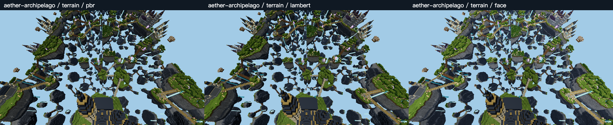
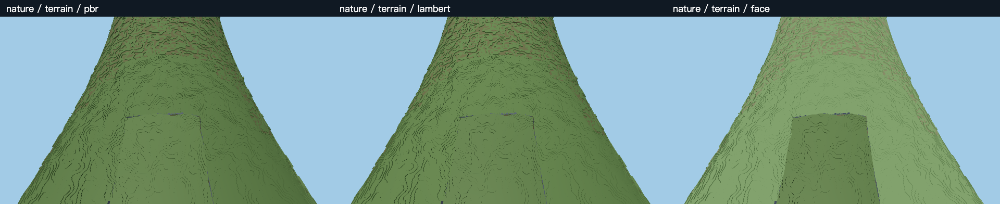
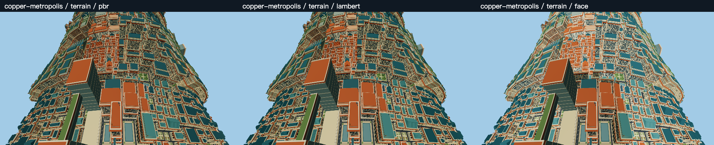

# Far lighting in three terrains — 2026-10-26

**Keep PBR as the default.** Replacing only distant terrain lighting with Lambert
or unlit face brightness reduces some measured GPU spans, but does not establish
a meaningful complete-frame FPS improvement on this machine. The unlit option
also changes the picture substantially and makes the near/far lighting boundary
more visible. These are development-only experiments; no production import or
default material changes were made.

[Open the interactive comparison and full-resolution images](performance-far-lighting-2026-10-26.html).
The [machine-readable summary](../src/dev/results/lighting-2026-10-26/summary.json)
and all compressed raw frames, GPU timelines, controls and PNGs are retained in
`client/src/dev/results/lighting-2026-10-26/`. Unlike the earlier low-poly trial,
these captures have been exported from the browser into the checkout.

## Scope and implementation

The trial keeps production packed greedy quads, Arena visibility, face-block
culling, LOD publication, command caching, curved positions, fog, emission and
near terrain. It changes the materials used by the distant voxel layer:

- **PBR:** the original `MeshStandardNodeMaterial`, roughness 0.65, metalness 0.15.
- **Lambert:** `MeshLambertNodeMaterial`, the same base colors, normals and scene
  lights, with diffuse reflection and no specular lobe. Colors are not retuned.
- **Face brightness:** `MeshBasicNodeMaterial` with scene lighting disabled.
  Vertex brightness is `0.45 + 0.55 * max(dot(n, normalize(0.4,0.8,0.3)), 0)`.
  Here `n` is the face normal in the unbent terrain frame. It is an artistic
  fixed direction, not a physical sun direction around the ring. Emissive pixels
  still use the production emission output.

The renderer hook temporarily substitutes cached materials during the world
render and restores the original mesh references immediately afterwards. It
executes the same traversal in all three roles. A mode change invalidates the
existing render bundle once, before warm-up; ordinary bundle caching stays on.
No geometry is copied, simplified, repacked or reindexed. Near terrain retains
PBR, so the third mode deliberately exposes the appearance cost of a distant-only
replacement. This is a whole distant-layer experiment, not a new distance cutoff.

## Measurement conditions

- Checkout base: `3eda06e7fc0651d982dc24fe387a0280d656d6cf`.
- Browser WebGPU adapter: `apple / metal-3`; device model is masked. Chromium
  reports 156.0.0.0. Native GPU clocks, power and temperature were not locked or
  recorded. Other applications were not controlled.
- Canvas 2560 x 1440; CSS viewport 1280 x 720, DPR 2; FOV 75 degrees. Medium
  lighting, fixed 100% resolution, 4x MSAA, shadows off, command caching on.
- Offline repeated-district fixture: 128 far districts and the normal 153-chunk
  near window. Game updates, sky and HUD remain active. This is not a live-server
  measurement or a claim about every location in these procedural worlds.
- Common player position `(8192.5, 180, 1024.5)`, yaw pi/2 and pitch -0.85.
  Fixed keeps that pose; sweep uses yaw `pi/2 + 0.6*sin(2*pi*t)`; move adds
  `16*sin(2*pi*t)` in X and `8*(1-cos(2*pi*t))` in Z. Physics and ordinary
  near/far maintenance continue; the fixture resets velocity and interpolation.
- All pipelines are preflighted at three views, then warmed through sweep and
  movement. Each accepted block has 1.2 seconds warm-up and 3 seconds sampling.
  Six permutations give each material six repetitions per motion, balanced
  twice at each position in a three-block round. The complete order is
  `ABC CBA BCA ACB CAB BAC`, where A=PBR, B=Lambert, C=face brightness.
- Each world also has six PBR-only blocks before and six after comparison:
  1 second warm-up and 2 seconds sampling per block. Their role labels are
  nominal; every actual material is PBR.
- FPS is `1000 / pooled mean RAF interval`, not a mean of displayed HUD values.
  CPU time is wall time inside the animation callback. GPU queries sample about
  one in six frames without synchronous per-frame readback. Reported GPU time
  is first-pass-start to last-pass-end span, not a hardware GPU busy counter.
  Timestamps on this adapter show approximately 0.066 ms quantization.
- Pixel captures, image encoding, builds, tests and export run outside accepted
  timing windows. The document stays visible; the Play overlay and diagnostics
  are hidden during measurement, while the main gameplay HUD remains visible.

Accepted comparisons contain 56,490 frames and 9,413 GPU samples, across 162
blocks. There are another 36 control blocks. No new material variants were
created in any accepted comparison block. All comparison and control runs report
zero uncaptured WebGPU errors. Warm-up captures are retained but excluded from
the result tables.

## Complete-frame results

GPU columns are pooled median spans in milliseconds. The observed roughly
120 FPS ceiling limits visible gains in the fixed and sweep workloads.

| World / motion | PBR FPS | Lambert FPS | Face FPS | PBR GPU ms | Lambert GPU ms | Face GPU ms |
| --- | ---: | ---: | ---: | ---: | ---: | ---: |
| Aether / fixed | 118.2 | 120.0 | 119.9 | 3.473 | 3.473 | 3.277 |
| Aether / sweep | 120.1 | 119.6 | 120.1 | 3.473 | 3.342 | 3.146 |
| Aether / move | 108.3 | 109.4 | 108.2 | 3.342 | 3.146 | 3.015 |
| Nature / fixed | 120.1 | 120.0 | 120.1 | 3.604 | 3.539 | 3.342 |
| Nature / sweep | 120.0 | 120.0 | 119.7 | 3.670 | 3.473 | 3.277 |
| Nature / move | 119.8 | 119.8 | 119.5 | 2.818 | 2.818 | 2.687 |
| Copper / fixed | 120.0 | 120.0 | 120.0 | 3.670 | 3.670 | 3.473 |
| Copper / sweep | 119.9 | 119.8 | 119.9 | 3.604 | 3.408 | 3.408 |
| Copper / move | 96.0 | 95.7 | 94.6 | 3.736 | 3.539 | 3.539 |

| Moving workload | CPU p50: PBR / Lambert / face, ms | Frame p95: PBR / Lambert / face, ms |
| --- | --- | --- |
| Aether | 4.5 / 4.4 / 4.4 | 16.7 / 16.7 / 16.7 |
| Nature | 3.3 / 3.2 / 3.2 | 9.1 / 9.1 / 9.1 |
| Copper | 5.0 / 4.9 / 4.9 | 18.1 / 18.2 / 18.3 |

Lambert's observed median GPU-span reductions are 0–5.9%; face brightness is
4.7–10.7%. These are measured span differences, not proven FPS gains or portable
speedup guarantees. GPU frequency variation, quantization and control noise are
material at these sizes. CPU medians change only about 0–0.1 ms. Moving-frame
tails do not improve. The data do not isolate a single universal bottleneck,
but they show that cheaper far shading is insufficient to solve the current
complete-frame performance problem under this workload.

## Controls and geometry checks

| World | PBR-only block FPS range before | PBR-only block FPS range after | GPU block p50 range before / after, ms |
| --- | --- | --- | --- |
| Aether | 107.74–120.26 | 119.99–120.50 | 3.146–3.539 / 3.473–3.670 |
| Nature | 119.95–120.00 | 119.94–120.04 | 3.604–3.932 / 3.342–3.670 |
| Copper | 118.05–120.06 | 119.92–120.24 | 3.604–3.736 / 3.604–3.736 |

Aether's fixed PBR blocks range from 111.0 to 120.2 FPS. Its pooled 118.2 to
120.0 difference must not be advertised as a stable lighting speedup. In moving
Aether, PBR blocks are 107.7–109.0 FPS, Lambert 108.7–110.1, and face 106.0–110.2:
the small Lambert difference merits at most another targeted repeat, not a
default-material change. Copper moving blocks overlap as well: 94.4–97.7,
93.8–97.1 and 92.7–96.7 FPS respectively.

Fixed-view median full-scene triangle counts are exactly equal across all three
materials within each world: Aether 1,795,993, Nature 602,163, Copper 2,305,023.
Camera motion samples different instants at slightly different frame rates, so
pooled moving geometry statistics need not be numerically identical. Normal
pending LOD/transition work appears in 274 Aether, 168 Nature and 177 Copper
sampled frames. It is retained as part of ordinary gameplay, not frozen away.

## Picture comparison

Each world has three matched views: terrain, across-ring and reverse. All 27
original PNGs are 2560 x 1440, with nine smaller labeled comparison strips.
Images are direct synchronous canvas copies after rendering; nonempty readback
is checked. A fourth restored-PBR capture at every pose has exactly zero pixel
difference from the first PBR image. Draw calls and triangles are identical
between all four captures, and picking is unchanged in all nine poses.

These checks establish restoration and sampled geometry consistency, not an
exhaustive proof for every cave, LOD seam or world-edit transition.

- **Lambert:** visually close to PBR in these rough voxel surfaces; specular
  response disappears and diffuse brightness shifts slightly. The lower image
  difference is consistent across all three terrains.
- **Face brightness:** distant surfaces become brighter and more uniformly
  colored. In Nature, the retained near-PBR area is a more obvious darker patch.
  Copper's distant facades become brighter and flatter; Aether's distant island
  faces lose some lighting variation. The silhouette and solid occlusion remain.
- Emissive pixels use the same output node. Their treatment is not replaced by
  the face-brightness equation.

The terrain-view mean of per-pixel maximum RGB channel difference (0–255) is
2.10 / 15.54 for Aether, 3.42 / 17.19 for Nature, and 3.42 / 20.91 for Copper,
in Lambert / face order. This is a difference measure, not a perceptual quality
score. Sky and unchanged near pixels are included, so it is not a far-only error.

## Recommendation and reproduction

Keep PBR for the default picture. Lambert is the better candidate for an optional
low graphics preset if testing on a slower, GPU-limited device justifies it; this
machine does not demonstrate that benefit. Do not adopt the current face-brightness
variant as a performance default: the visual change and near/far mismatch are
large compared with the observed complete-frame benefit.

Open the localhost offline fixture with the desired world and
`dev_offline=1&dev_lod=world&dev_dpr=2`. Use CSS viewport 1280 x 720, press Play,
set the common pose, enable distant terrain, and wait for near/far work to settle.
Explicitly import `FarLightingTrial.ts`, `FarLightingFrames.ts` and
`FarLightingPixels.ts` from `client/src/dev/` through Vite's `/@fs/` URLs. The
modules reject non-offline/non-development games and are not production imports.
Create the trial, preflight images, warm all modes/motions, run the controls and
`runFarLightingFrames(game, trial)`, then call `trial.dispose()` to restore PBR.
`client/tools/lighting-results.html` reads local IndexedDB captures and exports
the complete ZIP. It is a temporary live capture viewer; the report's comparison
HTML uses the durable exported files and requires no IndexedDB.

Regenerate the durable numeric summary with
`node client/tools/summarize-far-lighting.mjs`. It validates the expected block
counts, PBR-only controls, finite samples and all image consistency checks before
writing `summary.json`.

Validation: five focused order/timestamp/environment tests pass. Client typecheck
passes. Production build, offline-entry exclusion, production initialization and
compiler-worker checks pass, with existing vendor/circular-chunk/size warnings.
