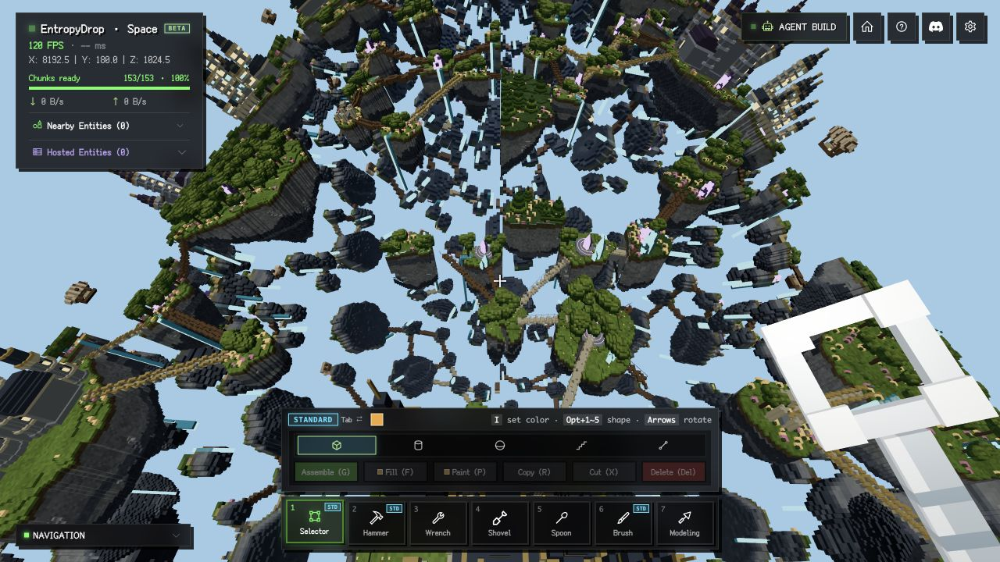

# Distant drawing GPU investigation, 2026-10-23

The third batch replaces each Arena page's full index buffer with a reusable
32-face indexed instance. Reserved face/map/index capacity falls from **94.50
MiB to 40.51 MiB (57.1%)**, with the same 2,089,207 resident faces. This change
is enabled by default for its substantial buffer saving. **The final timings
do not establish a stable GPU execution or FPS improvement.** The original
GPU bottleneck has not been eliminated; small execution-time regressions cannot
be excluded by these noisy measurements.

Two complete warmed passes of 16 visual/picking cases have zero changed pixels
and identical picking. Rapid-turn CPU p99 remains 8.0 ms before and after.
Resolution, lighting, view distance, LOD budget/selection, geometry, source draw
order, visibility guards, fades and input behavior retain their previous rules.

## Baseline and workload

The starting checkout was `517fa14` plus the still-uncommitted
[second batch](performance-turning-2026-10-23.md). The first and second batches
remain enabled in every third-batch reference and optimized run. The
[baseline SHA-256 manifest](../src/dev/results/gpu-drawing-baseline-manifest-2026-10-23.json)
identifies the relevant source files before this work. An
[original-code GPU baseline](../src/dev/results/gpu-drawing-original-2026-10-23.json)
was captured before implementation. Final comparisons use a same-load reference
switch to avoid confusing publication/page layout changes between reloads with
the effect of this batch.

- Local offline Aether fixture; 153 near chunks, 128 repeated districts,
  2,089,207 resident distant faces and nine Arena pages, with publication settled.
- In-app Chromium 155 on macOS; 1280 x 720 CSS, DPR 2, 2560 x 1440 drawing
  buffer, fixed resolution 100%. No freshly verified adapter model is asserted.
- Medium or Ultra lighting; shadows off for timings. The low-FPS far-terrain
  guard is intercepted only during these explicit probes and restored afterward.
- No online entities or server/network workload. The observed RAF ceiling is
  approximately 120 Hz; RAF cadence is not verified display presentation.
- No CPU profiling, screenshot readback, builds or test suites run during the
  final timed comparisons. Pixel checks and saturated GPU replay are separate.

## Retained implementation

[`VoxelFaceArena.ts`](../../engine/src/render/VoxelFaceArena.ts) previously
allocated 262,144 faces x six uint32 indices, or 6 MiB, for every page. The new
layout draws 32 faces per instance from 192 uint32 indices: **768 bytes per
page**. The vertex shader combines vertex and instance indices to address the
same packed face records and visibility maps. No geometry is re-published when
switching the reference path.

The existing visibility unit remains 16 faces. An odd number of blocks in a
draw run adds 16 padding faces to its final instance; their vertices collapse
and do not produce fragments. Mapping clamps to a valid run record before
reading storage. Real triangle order, color decoding, position arithmetic and
material/unmerged draw barriers stay intact. New `drawnFaces` and
`instancePaddingFaces` counters distinguish this extra padding from real faces.
The fixed Medium across view adds 384 padding faces across 44 Arena draws;
the near view adds 304 across 34. Whole-frame draw calls remain 48 and 270,
respectively, in their paired runs.

The development switch retires old materials/pipelines and geometry bindings
while retaining face/map storage. The legacy full index is allocated lazily
only when that reference is requested. Three r183 promotes non-normalized
uint16 index attributes to uint32 on this backend, so the retained code uses
uint32 explicitly and reports its actual size. The historical 48-byte face
budget in `DistantVoxelLayer` is deliberately retained: smaller buffers must
not silently increase selected geometry.

| Buffer accounting | Before | After | Reduction |
| --- | ---: | ---: | ---: |
| Index capacity, all nine pages | 54.00 MiB | 6.75 KiB | 99.99% |
| Face + map + index capacity, all nine pages | 94.50 MiB | 40.51 MiB | 57.1% |
| Existing GPU buffers, final across-view sample | 88.50 MiB | 40.51 MiB | 54.2% |
| Existing GPU buffers, final near-view sample | 82.50 MiB | 40.51 MiB | 50.9% |

The last two rows sum the backend's actual allocated `GPUBuffer.size` values
for current page face/map/index attributes. Some index buffers have not been
uploaded in that view, so they differ from reserved capacity. These are not
measurements of total process VRAM: near geometry, render targets, transitions,
CPU copies, driver resources and other renderer allocations remain separate.

## Final whole-frame results

The [final raw frame record](../src/dev/results/gpu-drawing-final-frames-2026-10-23.json)
contains 20 runs, in before / after / before-repeat / after-repeat order for
each workload. GPU runs warm for at least three settled seconds, then sample
24 seconds with asynchronous GPU timestamps on one frame in six. Each GPU
sample is the span from first pass start to last pass end, not the overlapping
pass-duration sum. Do not add it to CPU callback time.

| Workload | Before GPU mean, first / repeat, ms | After GPU mean, first / repeat, ms |
| --- | ---: | ---: |
| Medium fixed across ring | 2.693 / 3.067 | 2.896 / 3.091 |
| Medium fixed near view | 3.912 / 3.545 | 3.560 / 4.007 |
| Medium eight-second yaw sweep | 2.909 / 3.059 | 3.093 / 2.993 |
| Ultra fixed across ring | 5.660 / 4.997 | 4.993 / 5.245 |

Pair-averaged GPU means change by +3.9%, +1.5%, +2.0%, and -3.9%, respectively.
The repeat variation is larger than these differences. There is no consistent
improvement across workloads or repeat order, and the Medium means actually
increase. The buffer reduction is the supported benefit; these data must not
be advertised as GPU throughput gains. RAF rates span approximately 118.5-120.1
Hz with no consistent before/after improvement.

Rapid turning uses a four-second full yaw rotation with three-second pitch
motion. These four runs disable GPU queries and measure 32 seconds after
warm-up, independently of the GPU runs:

| Metric | Before, first / repeat | After, first / repeat |
| --- | ---: | ---: |
| CPU callback p99 | 8.0 / 8.0 ms | 8.0 / 8.0 ms |
| RAF interval p99 | 9.2 / 9.3 ms | 9.3 / 9.4 ms |
| RAF rate | 119.84 / 120.08 Hz | 120.00 / 119.53 Hz |

The final samples record zero new render pipelines during measurement and
zero pending Arena copies. Fixed-pose real visible-face and draw counts match.
Wall-time camera traces can end at slightly different poses, so moving endpoint
visibility counters are not expected to match exactly. The pixel and topology
tests provide the corresponding exact comparison.

## Saturated far-only GPU replay

[`GpuDrawingBenchmark.ts`](../src/dev/GpuDrawingBenchmark.ts) also captures the
renderer's actual distant-terrain render bundle and replays it into the same
render target with a fresh color/depth clear per pass. Each command buffer
contains 16 passes, preventing ordinary JavaScript render-submission gaps between
them. Each variant warms 32 batches (512 passes), then measures 32 more batches.
The measured first-start-to-last-end GPU span is divided by 16. Raw intervals
and CPU-to-map-completion measurements are retained in the
[final replay record](../src/dev/results/gpu-drawing-final-far-replay-2026-10-23.json).

| View / target configuration | Before GPU ms/pass, first / repeat | After GPU ms/pass, first / repeat |
| --- | ---: | ---: |
| Across, Medium | 0.961 / 0.872 | 0.905 / 0.903 |
| Near, Medium | 1.748 / 1.744 | 1.753 / 1.759 |
| Across, Ultra | 0.894 / 0.884 | 0.892 / 0.871 |

Pair-averaged changes are -1.3%, +0.6%, and -0.8%. This longer-warmed test does
not reproduce the more encouraging early short trials reliably. It includes
render-pass/clear overhead, excludes near occlusion, sky, Ultra post-processing,
simulation and presentation, and must never be inverted and called game FPS.
The Ultra row describes the target configuration, not execution of Ultra effects.
Validation scopes reported no GPU validation error.

## Rejected experiments

- **16-face instances and explicit shader storage locals.** Early short
  whole-frame trials looked encouraging. Saturated far-only replay instead
  increased the combined across-view time from about 0.865 to 1.044 ms/pass
  (about 21%). Both implementations were removed. The
  [index trial](../src/dev/results/gpu-drawing-index-trial-2026-10-23.json),
  [storage-local trial](../src/dev/results/gpu-drawing-pulls-trial-2026-10-23.json),
  [rejected candidate's frame runs](../src/dev/results/gpu-drawing-frame-comparison-2026-10-23.json),
  [replay rejection](../src/dev/results/gpu-drawing-small-block-replay-2026-10-23.json)
  and [trial pixels](../src/dev/results/gpu-drawing-pixels-trial-2026-10-23.json)
  remain available. They are not measurements of the final implementation.
- **Instance group sizes 32-1024.** The
  [group-size sweep](../src/dev/results/gpu-drawing-group-sizes-2026-10-23.json)
  informed the 32-face choice. Those shorter-warmed results are exploratory;
  the longer-warmed final replay above takes precedence.
- **Skipping zero camera-local torus correction.** The
  [projection trial](../src/dev/results/gpu-drawing-projection-trial-2026-10-23.json)
  passed pixels but did not show dependable speedup. It was fully removed;
  `TorusWorld.ts` is unchanged from the baseline.

The [reference vertex shader](../src/dev/results/gpu-drawing-reference-2026-10-23.wgsl),
[rejected small-block shader](../src/dev/results/gpu-drawing-rejected-small-block-2026-10-23.wgsl),
and [final vertex shader](../src/dev/results/gpu-drawing-final-2026-10-23.wgsl)
are retained. A reduction in textual storage-load expressions alone is not
proof of fewer hardware loads or better execution time.

## Correctness and reproduction

The [pixel/picking record](../src/dev/results/gpu-drawing-final-pixels-2026-10-23.json)
contains near / across / turned / reverse views at Medium and Ultra, with
shadows on and off, comparing reference / optimized / reference-repeat over
3,686,400 pixels. Both complete warmed repetitions have **zero changed pixels,
zero channel delta and identical picking in all 16 cases**. Images are nonempty.
The warm-up pass's first Ultra near case changes 862 pixels by at most eight
channel levels in both optimized and repeated reference captures. Because the
reference itself changes identically, this is retained as an unstable warm-up
comparison rather than a pass or a variant-specific failure.



The new topology test decodes actual indices, instance counts and storage maps
into ordered real vertices across partial blocks, masked materials, unmerged
barriers and source removal. A resource-lifetime test checks reference switches,
unchanged storage, idempotence and material retirement. Existing coverage,
streaming, editing, source reconstruction and disposal tests also run against
the new default path. These tests and the fixed fixture do not cover every
driver or multiplayer interaction.

Open the local development fixture:

```text
/space/app/?dev_offline=1&world=aether-archipelago&dev_lod=world&dev_perf=1&dev_dpr=2
```

Use a 1280 x 720 CSS viewport, enter Play, close the profiler, and wait for the
fixture to settle. Import `src/dev/GpuDrawingBenchmark.ts` in the development
console (Vite serves this workspace file through `/@fs/`). Set camera yaw to
`Math.PI / 2`, and pitch to `1.35` for across or `-.85` for near. Alternate
`setGpuDrawingVariant(game, false)` and `setGpuDrawingVariant(game, true)` around
`sampleGpuDrawing(game, label, { motion: 'fixed', gpu: true, durationMs: 24000 })`.
Use `motion: 'sweep'` for the yaw trace and `motion: 'rapid', gpu: false,
durationMs: 32000` for CPU turning. `sampleFarBundle(game)` runs the saturated
reference / optimized / reference-repeat / optimized-repeat diagnostic.
`checkGpuDrawingPixels(game)` is separate from all timing; warm it, then repeat.
Temporarily hold far terrain on during a series so the low-FPS guard cannot
change the workload between calls, and restore that guard in `finally`.

The benchmark modules are explicit development imports, absent from the
production application graph. The retained runtime path changes only drawing
layout and buffer capacity. Future speed work needs another measured reduction
in far vertex/shading work while proving equivalent output; this experiment
does not establish exclusive shader, bandwidth or driver costs.

## Validation

- Engine suite: **634/634 passed**, including the two new drawing tests.
- Client suite: **1512/1515 passed**. The same three failures recorded in the
  [previous batch](performance-turning-2026-10-23.md) remain: the
  `entity-menu-icons` test loader rejects `OnlineSpaceNotice.tsx`, and two
  `shovel-cursor` entity-outline assertions receive null. These were already
  reproduced on the original first-batch baseline; this run adds no new failure.
- Engine and client TypeScript checks, including inventory typing, passed.
- Production build, its four module-initialization import-order checks, and
  compiler-worker checks passed. The existing large-chunk warning remains.
- English-only validation, documentation links, generated API documentation,
  and `git diff --check` passed. Browser error logs were empty after the final
  pixel checks. Temporary diagnostic overrides and the test tab were cleaned up.
