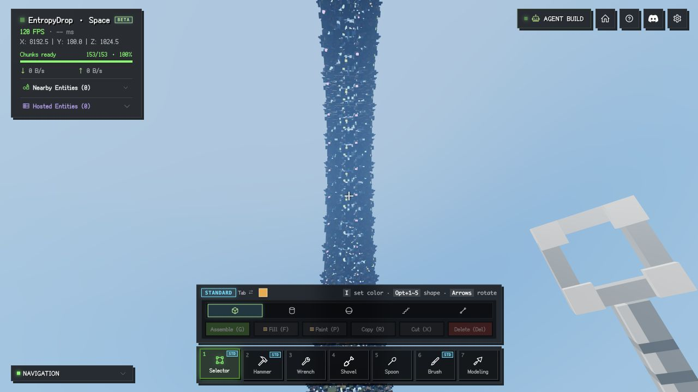

# Distant GPU execution investigation, 2026-10-23

The fourth batch identifies and implements a compact visibility-map candidate,
but **does not enable it by default**. Isolated Medium across-ring GPU execution
improves 4.3%, while ordinary turning whole-frame GPU spans regress by 6.2% in
the initial comparison and 8.1% in a reverse-order follow-up. The candidate
therefore **fails the full-frame acceptance gate**. Normal use keeps the original
map layout; this batch must not be presented as a shipped GPU/FPS speedup.

The candidate packs each 16-face visibility block into one 16-byte map record
instead of two vec4 records (32 bytes), preserving face records, geometry,
triangle order, origin arithmetic, LOD selection, transitions and interactions.
The explicit development switch is retained for reproduction and further work.

When enabled, the candidate's nine-page face/map/index capacity falls from
40.51 to 38.26 MiB (5.6%), and map capacity/upload volume halve. Two complete
warmed passes of 16 pixel/picking cases have zero changed RGB pixels and
identical picking. Rapid-turn CPU callback p99 changes from 8.2/8.3 to 7.9/7.9 ms;
RAF interval p99 stays 9.3 ms. These benefits do not justify silently accepting
the measured ordinary-frame GPU regression.

## Baseline and measurement conditions

The starting checkout is `517fa14` plus the first three optimization batches.
The [baseline source manifest](../src/dev/results/gpu-execution-baseline-manifest-2026-10-23.json)
identifies the pre-edit files. The earlier optimizations remain enabled in both
variants. An [initial original-code record](../src/dev/results/gpu-execution-initial-2026-10-23.json)
was saved before implementation; final comparisons use the same loaded world
and change only the map representation.

- Local offline Aether fixture, 128 repeated districts, 153 near chunks,
  2,089,207 resident distant faces, nine Arena pages, settled publication.
- In-app Chromium 155 on macOS, Three r183 WebGPU, native timestamp queries.
  CSS 1280 x 720, DPR 2, drawing buffer 2560 x 1440, fixed resolution 100%.
- Medium/Ultra lighting, shadows off for timings. Visual tests cover both
  shadow states. View distance, geometry budget and selected terrain stay fixed.
- A fresh adapter query exposes Apple / Metal 3 but no model. This is not a
  verified identity/model for the existing renderer device; see the
  [environment record](../src/dev/results/gpu-execution-environment-2026-10-23.json).
- The low-FPS distant-terrain guard is intercepted only during explicit probes
  so it cannot silently remove terrain from a slow sample. It is restored afterward.
- No profiling overlays, screenshot readback, builds or test suites run during
  final timing. GPU replay, ordinary frame sampling and CPU-only turns are separate.
- This has no online entities/server workload. RAF is near its observed 120 Hz
  ceiling; it is not independently verified display presentation.

## What the isolation probes establish

The [isolation record](../src/dev/results/gpu-execution-expansion-trial-2026-10-23.json)
replays the actual far render bundle with the same target and a fresh clear per
pass. A one-pixel scissor removes almost all raster/fragment work; a rejecting
depth clear is a second diagnostic. Neither is a production quality change.

| Reference diagnostic | Across GPU median, ms/pass | Near GPU median, ms/pass |
| --- | ---: | ---: |
| Normal pass | 0.818 | 1.776 |
| One-pixel scissor | 0.860 | 1.536 |
| Rejecting depth clear | 0.834 | 1.550 |

Across-ring cost barely responds to removal of fragment work. Near-view cost
falls about 13-14%, leaving most cost upstream or in fixed pass/geometry work.
This points toward vertex/primitive processing and data access, rather than
fragment shading alone. It is an inference from controlled interventions,
not a hardware-counter proof of bandwidth saturation, cache misses or occupancy.

Empty-pass timestamps are **invalid on this backend**: the end query returns
zero while the beginning is nonzero. The harness rejects the negative span
and records the failure. No empty-pass cost is subtracted, no absolute values
are substituted, and those results are excluded from comparisons.

## Retained experimental implementation

[`VoxelFaceArena.ts`](../../engine/src/render/VoxelFaceArena.ts) stores
`[start * 32 + count, origin.x, origin.y, origin.z]` per visible block. The page
has at most 2^18 faces, and the 1..16 count occupies five low bits. The packed
integer is below 2^23, hence exactly representable in Float32. The shader
extracts start/count with integer shift/mask operations. Origins retain their
original Float32 representation, including negative coordinates and nonzero Y.
The same local-offset-plus-origin arithmetic feeds torus projection and shading.

This removes the second map-record lookup for origin Z. No face or vertex data
is pre-expanded, re-sorted or culled differently. CPU visibility caches and GPU
maps both use the compact layout, so enabling the candidate does not maintain a
second representation or perform an extra repacking pass.

`setCompactMapsEnabled(false)` reconstructs the original layout for development
comparisons. Switching invalidates only visibility maps/materials, retains
resident face records and retires old map GPU buffers for every registered
renderer. Returning to the compact path does not retain reference buffers.
The historical face-budget estimate remains unchanged so memory savings cannot
silently select more detail.

| Nine-page reserved capacity | Before | After |
| --- | ---: | ---: |
| Face records | 36.00 MiB | 36.00 MiB |
| Visibility maps | 4.50 MiB | 2.25 MiB |
| 32-face indices | 6.75 KiB | 6.75 KiB |
| Total | 40.51 MiB | 38.26 MiB |

These are Arena allocations, not total process VRAM. Near meshes, render
targets, driver resources, CPU copies and other renderer allocations are separate.

## Candidate native GPU replay

[`GpuExecutionBenchmark.ts`](../src/dev/GpuExecutionBenchmark.ts) uses the actual
render bundle captured by [`GpuDrawingBenchmark.ts`](../src/dev/GpuDrawingBenchmark.ts).
Each command buffer contains 16 passes, without JavaScript submission gaps
between passes. Each variant warms 32 batches, then measures 32 batches.
The metric is the native first-start-to-last-end GPU timestamp span divided
by 16. Per-pass durations can overlap on this backend and are not summed.

The [forward record](../src/dev/results/gpu-execution-final-replay-pixels-2026-10-23.json)
uses before/after/before/after; the
[reverse record](../src/dev/results/gpu-execution-final-reverse-2026-10-23.json)
uses after/before/after/before. Each summary below averages the four per-run
medians, giving every run equal weight.

| View / target | Before ms/pass | After ms/pass | Observed change | Interpretation |
| --- | ---: | ---: | ---: | --- |
| Medium across ring | 0.898 | 0.859 | -4.3% | All four pairs improve |
| Medium near | 1.783 | 1.770 | -0.7% | Below repeat variation |
| Ultra across ring | 0.886 | 0.879 | -0.8% | One reverse pair regresses; no stable win |

Medium across reference medians are 0.934/0.897/0.885/0.877; optimized medians
are 0.864/0.881/0.868/0.823. This supports a modest GPU throughput improvement
in that workload. Near and Ultra should not be advertised as established gains.
Replay includes pass/clear overhead, excludes near occlusion, sky, simulation,
presentation and Ultra effects, and must never be inverted into game FPS.
Validation scopes reported no GPU validation errors.

The captured [reference WGSL](../src/dev/results/gpu-execution-before-2026-10-23.wgsl)
and [compact WGSL](../src/dev/results/gpu-execution-after-2026-10-23.wgsl)
show the corresponding map lookup change. Generated source length grows because
TSL expands the packed-header decoding; source length alone did not predict
native GPU performance.

## Candidate normal frames and interaction latency

The [20-run frame record](../src/dev/results/gpu-execution-final-frames-2026-10-23.json)
uses at least three settled warm-up seconds and 24 measured seconds for GPU
runs, sampling native timestamps on one frame in six. Each row has before /
after / before-repeat / after-repeat runs. Whole-frame GPU span includes all
render passes and possible gaps between their submissions; it is not identical
to isolated far GPU execution or CPU callback time.

| Workload | Before GPU mean, first / repeat, ms | After GPU mean, first / repeat, ms | Pair-average change |
| --- | ---: | ---: | ---: |
| Medium fixed across | 2.687 / 2.573 | 2.564 / 2.604 | -1.7% |
| Medium fixed near | 3.827 / 3.536 | 3.581 / 3.312 | -6.4% |
| Medium eight-second yaw sweep | 2.633 / 2.686 | 2.556 / 3.095 | +6.2% |
| Ultra fixed across | 5.266 / 5.155 | 5.257 / 5.017 | -1.4% |

The high second optimized sweep sample is not removed. These ordinary-frame
results do not establish a general GPU improvement: sweep variation is large,
and near-frame improvement is larger than the isolated far change. FPS stays
near 120 with no consistent increase. Fixed-pose face/draw counts match; moving
traces use wall time and can end at slightly different poses. Every measured
run has zero new render pipelines and zero pending Arena publication.

A [reverse-order sweep follow-up](../src/dev/results/gpu-execution-sweep-reverse-2026-10-23.json)
reloads the same fixture and runs after / before / after / before for 24 seconds
each. GPU means are **3.336 / 2.969 / 3.145 / 3.024 ms**: the candidate average
is 3.240 ms versus 2.997 ms, **8.1% slower**. Both pairs regress, with no new
pipelines, no pending copies and RAF still near 120 Hz. The new load has a
different settled page/run layout, so these values are not pooled with the
first load to manufacture a single result.

[Six fixed-direction native replays](../src/dev/results/gpu-execution-yaw-replay-2026-10-23.json)
help separate far drawing from the full-frame symptom. At pitch 0.35, the
actual sweep endpoints (yaw pi/2 minus/plus 0.6) improve **4.5% and 6.2%** in
their paired far-only medians. The center and reverse heavy views improve
5.2% and 3.4%. The lighter yaw-zero view instead regresses 3.1%, while yaw pi
changes about -1.4%. Thus the candidate has a workload-dependent GPU tradeoff;
its favorable far-only timings do not invalidate the full-frame regressions.
Power/frequency behavior, submission overlap and compiler/vertex-data effects
remain possible explanations, not established causes. Browser timestamps do
not provide the vendor counters needed to distinguish them. The local command
`xcrun --find xctrace` also exits 72: the native trace utility is unavailable. The safe result
is to keep the candidate disabled, not to discard the unfavorable measurements.

The four rapid-turn runs disable GPU queries and measure 32 seconds each after
warm-up. Yaw makes a full rotation every four seconds while pitch oscillates
with a three-second period.

| CPU-only rapid turns | Before, first / repeat | After, first / repeat |
| --- | ---: | ---: |
| CPU callback p99 | 8.2 / 8.3 ms | 7.9 / 7.9 ms |
| Arena update p99 | 4.7 / 4.6 ms | 4.7 / 4.6 ms |
| RAF interval p99 | 9.3 / 9.3 ms | 9.3 / 9.3 ms |
| RAF rate | 119.97 / 120.00 Hz | 120.09 / 120.02 Hz |

## Rejected experiments

The trial records are retained so encouraging short samples cannot be mistaken
for shipped improvements. Only the disabled compact-map candidate remains in engine source.

| Experiment | Evidence and decision |
| --- | --- |
| [Branchless face expansion](../src/dev/results/gpu-execution-expansion-trial-2026-10-23.json) | No stable GPU reduction; reverted. Includes the scissor/depth isolation above. |
| [Four-face visibility blocks](../src/dev/results/gpu-execution-fine-trial-2026-10-23.json) | Fewer submitted faces and small near GPU gains, but CPU p99 grew from about 10 to 23.6 ms and several views changed 1-4 pixels. Reverted. |
| [Pre-expanded coordinates](../src/dev/results/gpu-execution-preexpanded-trial-2026-10-23.json) | Increased face data from 16 to 40 bytes and made GPU execution slower despite saving expansion arithmetic. Reverted. |
| [Native instance map attributes](../src/dev/results/gpu-execution-native-map-trial-2026-10-23.json) | Did not improve timings; also requires additional cached-bundle attribute refresh work. Reverted. |
| [Early per-face backface rejection](../src/dev/results/gpu-execution-cull-trial-2026-10-23.json) | Pixel-identical in tested views, but about 17-24% slower with extra plane data/branch work. Reverted. |
| [Identity matrix elimination](../src/dev/results/gpu-execution-world-matrix-trial-2026-10-23.json) | Small initial differences did not establish a stable gain. Reverted. |
| [Normal/correction arithmetic](../src/dev/results/gpu-execution-math-trial-2026-10-23.json) | Early near gains did not survive the [longer interleaved repeat](../src/dev/results/gpu-execution-math-repeat-2026-10-23.json). Reverted. |
| [Explicit storage temporaries / integer addressing](../src/dev/results/gpu-execution-access-trial-2026-10-23.json) | Explicit temporaries slowed execution; integer-only changes were inconsistent across views. Neither is retained. |
| [Compact-map prototype](../src/dev/results/gpu-execution-compact-trial-2026-10-23.json) and [repeat](../src/dev/results/gpu-execution-compact-repeat-2026-10-23.json) | Promising, then rewritten to avoid dual map storage/repacking. Final numbers above come from the retained disabled candidate, not the more favorable prototype. |

The first compact prototype had a two-pixel reference-repeat fluctuation with
shadows; the optimized image matched its reference. Both final warmed passes
are clean. Potential explanations involving cache behavior, register pressure
or bandwidth are hypotheses, not measured vendor performance counters.

## Validation and reproduction

Engine tests pass 637/637. Client tests remain at the baseline 1512/1515:
`entity-menu-icons` rejects the existing `OnlineSpaceNotice.tsx` test import,
and two `shovel-cursor` cases receive null entity outlines. Engine/client type
checks, production build (including import-order and compiler-worker probes),
English-only text, documentation links and generated API documentation checks
pass. The final default-off engine suite was rerun successfully. These unrelated
baseline client failures are not changed by this batch; the
[check record](../src/dev/results/gpu-execution-checks-2026-10-23.json) records the scope.

The final visual record contains two complete passes over four views, Medium /
Ultra and shadows off/on: **32 comparisons**, each with an optimized image and
an additional reference repeat, all with zero changed pixels and identical
picking. Unit coverage checks every 1..16 tail count at the final page block,
negative/nonzero origins, material/unmerged barriers, range reuse, new source
publication, exact topology and multi-renderer map-buffer retirement.

Use the offline fixture URL
`/space/app/?dev_offline=1&world=aether-archipelago&dev_lod=world&dev_perf=1&dev_dpr=2`
with CSS 1280 x 720. Wait for 2,089,207 resident faces and no pending transitions.
In development, `voxels.setCompactMapsEnabled(false/true)` selects the reference
or experimental compact map (disabled by default). `checkGpuExecutionPixels(game)` and `sampleGpuExecution(game)`
provide separate correctness and saturated GPU probes; `sampleGpuDrawing`
accepts fixed/sweep/rapid motion and optional GPU queries. Keep every other
setting fixed and do not run tests/builds while measuring.

