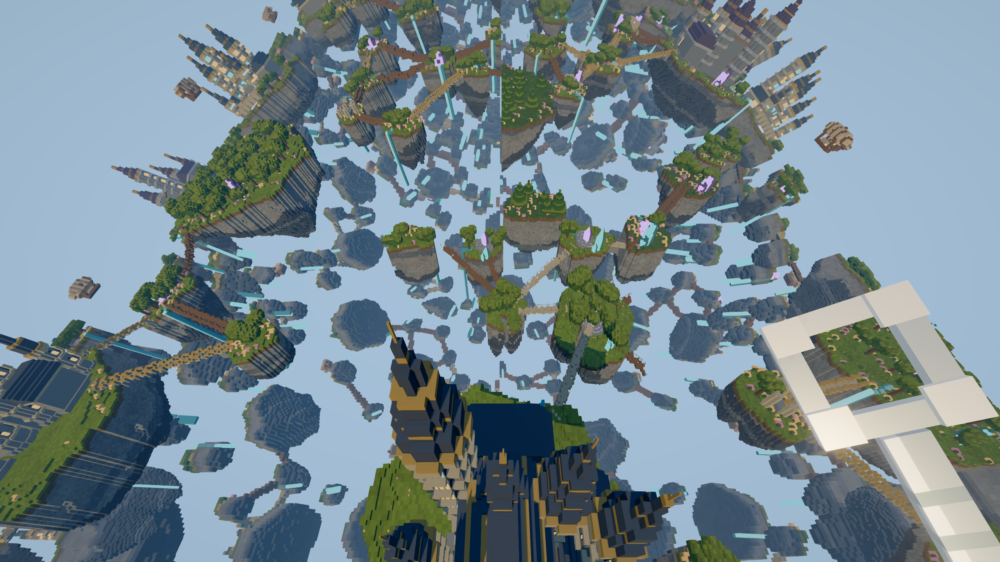

# GPU bandwidth optimization, 2026-11-02

The previous optimization reduced CPU visibility work but did not establish a
frame-rate improvement. This experiment targets the distant voxel vertex output
that dominated the native geometry workload.

## Implementation

Native distant terrain exports the existing packed color and material flags as
two flat unsigned integers. The fragment shader reconstructs the same values
and evaluates the original lighting equations. The declared varying payload
falls from 14 to 10 scalar components, or 8 when ownership sampling is proven unnecessary, excluding clip position; actual device
layout is implementation-dependent. Near terrain, entities, and shadow rendering
retain their original pipelines. The source face store remains 16 bytes per face.

Web carries the original packed color and emission byte as one flat `u32` and calls the existing
`unpack4x8unorm` in the fragment stage. This replaces a three-component color
varying and a separate emission varying without changing geometry, visibility, normal calculations, PBR,
emission, coverage, draw order, or LOD budgets. Both paths retain a reference
switch for development comparisons and enable the candidate by default.

There is no additional color quantization. Ultra, full render resolution,
4x MSAA, shadows, AO, clouds, atmospheric effects, bloom and FXAA remain enabled.

Native also uses a discard-free pipeline only for opaque, untransformed far
meshes whose padded flat bounds contain no owned cells. A wrapped prefix sum
checks both mask channels, including partial values. Coverage changes invalidate
the proof; uncertain batches keep the mask shader. Geometry and draw ordering
remain unchanged. Web already had an opaque ownership fast path.

## Measurement protocol

- Native `--profile-gpu`: frozen 128-zone Aether geometry, 720p and 1440p,
  20 balanced short A/B batches per stationary/turn/moving/moving-with-UI case.
  GPU timestamps and serial submit/wait durations are not displayed FPS.
- Native `--profile-window-gpu`: the actual window loop with streaming, physics,
  UI layout, cloud animation and presentation. Player saves are read but never
  written. After loading all 128 zones, the camera prewarms its movement path.
  Candidate blocks are interleaved with identical-code controls. VSync is off
  for measurement; normal application defaults are unchanged.
- Web `visibility-browser.html?trial=packed&world=...`: Chrome, 2560x1440 backing
  canvas, Ultra at 100%, 4x MSAA and shadows. Same geometry budgets and CPU
  hierarchy in both modes. Main run, moving replication, identical-code control,
  frozen image comparisons and picking checks for each world.

The native and Web worlds use their existing, different LOD budgets. These are
within-client comparisons, not a native-versus-Web speed contest. Builds, tests
and other benchmark renderers do not run concurrently with measured samples.

## Excluded experiments and controls

The initial native all-material variant changed a few near-view pixels. Keeping
the original floating color varying reduced the GPU benefit and did not remove
the small numerical differences. Adding `invariant` only to the new Metal
position path changed rasterization relative to the existing shader and was
rejected. The retained path uses the original position arithmetic.

The first native window run started timing before the moving LOD workload had
warmed up. It is retained as `window-gpu-cold-excluded.json` and is excluded from
the performance conclusion. A subsequent run without foreground/occlusion
validation is also excluded from visible-FPS claims. The final diagnostic waits
for focus before warming and fails on focus loss, occlusion or resizing during
sampling. A loading timeout that incorrectly included the movement warm-up was
fixed before the final diagnostic run.

The first Web attempt rebuilt reference materials on every switch. Returning to
the reference changed one pixel by 1/255 despite candidate images matching.
Reference and candidate material identities are now reused within a page, so
switching does not change material sort identities or repeatedly recompile
pipelines. Both variants are retired on geometry-layout changes or page disposal;
a regression test checks identity, unchanged geometry and single disposal.

## Native matched GPU results

Apple M1 Pro, 11,239,907 resident faces. Values below are GPU medians,
not FPS estimates. Each row has 480 samples per variant.

| Motion | Resolution | Previous ms | Optimized ms | Reduction |
|---|---|---:|---:|---:|
| stationary | 1280x720 | 4.996 | 3.502 | 29.9% |
| stationary | 2560x1440 | 7.326 | 5.501 | 24.9% |
| turn | 1280x720 | 5.191 | 3.565 | 31.3% |
| turn | 2560x1440 | 7.446 | 5.503 | 26.1% |
| moving | 1280x720 | 5.344 | 3.869 | 27.6% |
| moving | 2560x1440 | 7.747 | 5.837 | 24.7% |
| moving_ui | 1280x720 | 5.556 | 4.016 | 27.7% |
| moving_ui | 2560x1440 | 7.844 | 5.988 | 23.7% |

## Native foreground window results

The final run completed all 16 blocks with `focused=true`, `occluded=false`,
and a constant **1788x2178** physical window size. It used 11,283,503 resident
faces initially, Ultra at 100%, 4x MSAA and 4096px shadows. Normal streaming,
physics, UI layout, clouds and presentation remained active. Builds and tests
had finished before this run. The test exited automatically and preserved the
player's save.

| Metric | Previous | Optimized | Change |
|---|---:|---:|---:|
| Window render/present-loop FPS | 128.10 | 135.03 | +5.4% |
| Mean frame interval | 7.806 ms | 7.406 ms | -5.1% |
| Median frame interval | 7.281 ms | 6.691 ms | -8.1% |
| p95 frame interval | 15.518 ms | 15.694 ms | +1.1% |
| Mean completed-frame GPU duration | 15.023 ms | 13.200 ms | -12.1% |
| Identical-code control FPS, label A/B | 129.28 | 129.04 | -0.2% |

The main comparison contains 2,051 reference and 2,162 candidate samples;
controls contain another 4,132 samples. Every candidate block exceeds the
reference blocks in frame cadence. Tail latency did not improve: the candidate
also has one 80.8 ms maximum frame versus 32.2 ms for the reference, so these
measurements support higher average throughput, not a stutter-free claim.

VSync is disabled only for this diagnostic. FPS counts completed iterations of
the real window render/present loop, not unique display scanouts; monitor refresh
still limits visible frames. In-flight GPU durations can overlap and must not
be inverted into FPS. This live workload has different resolution, LOD and
compositor work from the frozen GPU test, so its smaller gain is expected and
should be reported separately.

Per-block results, frame/GPU distributions, visibility statistics and source
hash are in [window.json](../src/dev/results/gpu-port-2026-11-02/window.json).
Full raw samples remain in `native-space/results/window-gpu.json`.

## Native image and resource checks

Correction from the later frame-submission investigation: modes with no initial
timed rounds captured these first seven pairs before explicitly freezing cloud
time. The observed differences below are historical measurements, but cannot
be attributed solely to varying precision. `optimized()` now freezes cloud time
before any paired images. Timed GPU batches already froze it and are unaffected.
See the [follow-up validation](performance-frameflow-2026-11-02.md).

Seven full-quality paired views include overview at both resolutions, turning,
close geometry, the near/far transition, torus seams and material fixtures.
Geometry, masks and quality settings are unchanged, but the new varying layout
is **not bit-identical**. Three pairs are exact; three differ by at most 1/255.
The 720p close view has 22 pixels out of 921,600 differing by more than 2/255;
maximum channel difference is 29/255 and mean absolute RGB difference is
0.00842/255. Before postprocessing, the close-view maximum is 3/255, consistent
with small shader/interpolation rounding amplified by nonlinear postprocessing.
This attribution is an inference from the isolated capture, not a claim that
all changed pixels are identical internally.

The existing queued-resource checks still have zero differing pixels across
36 frames and 20 shadow invalidation cases. Ordered main/shadow visibility
matches the linear oracle over 144 moving frames. Sky stability is retained
across 128 translated frames, including both seams. Native format, Clippy,
31 Rust tests and four Node integration tests pass. Structured measurements
and exact image counts are in [native.json](../src/dev/results/gpu-port-2026-11-02/native.json).

## Web results

Chrome 156 / WebGPU, Apple M1 Pro. The main moving run reports the following
whole-frame GPU means and measured browser-frame cadence:

| World | GPU previous -> packed | GPU reduction | FPS previous -> packed |
|---|---:|---:|---:|
| Aether | 5.999 -> 5.847 ms | 2.5% | 111.41 -> 113.81 |
| Copper | 7.432 -> 7.473 ms | -0.5% | 100.83 -> 101.06 |
| Nature | 4.161 -> 4.156 ms | 0.1% | 119.99 -> 120.01 |

Movement replication and identical-code controls qualify these results:

| World | Replication FPS previous -> packed | Replication GPU previous -> packed | Identical-code FPS label A -> B |
|---|---:|---:|---:|
| Aether | 103.35 -> 114.72 | 6.018 -> 5.655 ms | 115.42 -> 114.61 |
| Copper | 99.63 -> 98.45 | 7.429 -> 7.390 ms | 98.20 -> 97.40 |
| Nature | 103.09 -> 99.39 | 5.148 -> 5.258 ms | 119.99 -> 119.99 |

Aether's GPU reduction repeats, but its replication FPS difference is inflated
by slow early reference blocks (88.5/94.9 FPS versus 114/116 later). Nature's
replication also drifts from roughly 80-94 FPS to 118-119 FPS for both variants;
its main run and control reach the 120 Hz browser cadence. Copper's differences
are smaller than its identical-code GPU variation (2.7%). Therefore the data do
**not** establish a uniform Web FPS improvement. The lossless packed varying is
enabled by default; Web already had the opaque ownership fast path, so the
larger native benefit should not be expected from this port alone.

All 165 frozen captures across the three worlds, including restored references,
match exactly; picking checks and runtime/GPU validation report no errors.
The suite contains 96 blocks, 26,720 sampled frames and 4,448 GPU timestamp
samples. Main, repeat and control results, per-block values and environment
details are retained in [summary.json](../src/dev/results/gpu-port-2026-11-02/summary.json).
[captures.json](../src/dev/results/gpu-port-2026-11-02/captures.json) records source
hashes, accepted capture IDs, excluded experiments and measurement limits.
Raw compressed captures remain in the ignored local capture directories.

The Aether main capture overlapped a metadata-text-only development update;
shader/render code was unchanged, and replication/control used unchanged files.
These are local workstation measurements with observable system noise, not
cross-device performance guarantees.

## Build and regression checks

- Native format/Clippy, 31 Rust tests, four Node integration tests, TypeScript
  checks and the signed local release bundle pass.
- All 673 engine tests and 1,675 client tests pass. Client typechecking,
  production build and production-module/compiler-worker boundaries pass.
- Documentation links pass. The repository-wide English-only check still
  reports 275 existing lines in three native documents; comparison with HEAD
  confirms no new violations. The existing production chunk-size warning remains.
- The player's Aether save hash is unchanged. Diagnostic movement is ephemeral.

The compact check record is [validation.json](../src/dev/results/gpu-port-2026-11-02/validation.json).
