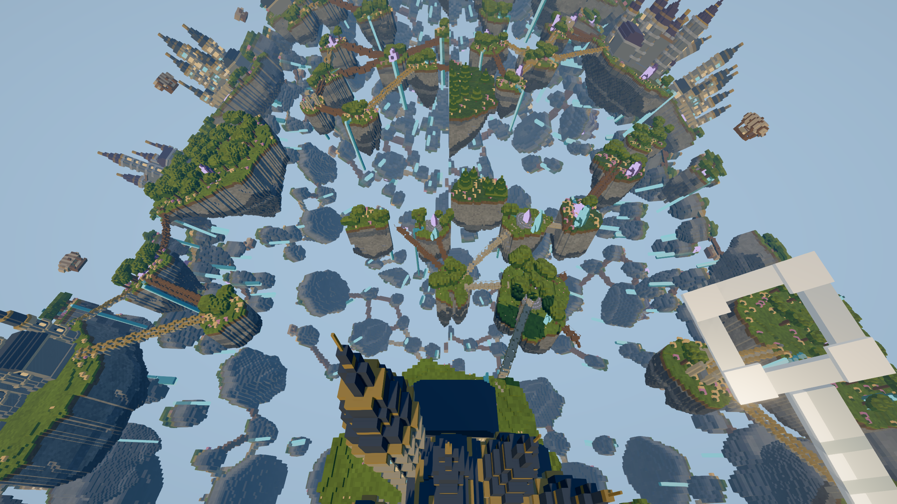

# Native visibility optimizations in the Web renderer

The Web packed-face arena now uses an ordered sphere/normal-cone hierarchy by
default. Nodes preserve source ranges and pass conservative plane/cone proofs
to descendants. Ambiguous leaves use the previous Float64 formulas, including
the existing 32 m translation guard, 34 m padding and .121 angular allowance.
Lazy position caches retain distance/facing results across camera rotation.
The tree writes ordered visible indices directly; the arena visits only these
indices instead of scanning every rejected block again. A prefix count of fully
covered blocks keeps subtree statistics constant-time without changing coverage.
Coverage, projection changes, material transitions, original face ordering,
GPU map layout, grouping, PBR shading and quality settings are preserved.
The optional lossy torus surface filter retains its previous implementation.

This ports the native hierarchy's approach rather than copying Metal-specific
APIs into Three. Packed 16-byte faces and groups of 32 faces were already in
Web production. This change does not alter them. The previous linear cache is
available through `setHierarchicalVisibilityEnabled(false)` for A/B checks.
Back/outside diagnostic counters report the hierarchy proof used; their split
can differ from the previous leaf-test precedence. Visible and covered face
counts remain exact. Tree metadata is released with each entry and invalidated when bounds change.

## Validation and measurement

- The hierarchy test compares ordered visibility for 8,197 blocks over 240
 views, including rotation, translation, clipping changes, nonunit/empty planes,
 flat projection and camera-local torus bending.
- Arena integration tests compare ordered maps, face counts, coverage changes,
 geometry replacement, rendering modes, texture replacement and resource cleanup.
- Browser tests use Chrome, a 1280 × 720 CSS fixture at DPR 2, Ultra, shadows on,
 fixed 100% resolution, and unchanged LOD/settings between the two variants.
 Native and Web workloads are not matched against each other. Web retains its
  existing subdivision target 64 px², distance 2048 chunks, 512 MiB source budget
  and 160 MiB geometry budget in both variants.
- Eight balanced A/B blocks per motion run in ordinary game frames. A moving
 repeat and identical-linear-code control follow. Warmup is excluded. Results
 contain whole-frame CPU, GPU timestamp spans, arena CPU, frame intervals and
 resident geometry counts. Image and picking checks use frozen publication and handoff time. The
  first unfrozen-handoff capture failed its identical-code restore by one color
  level; it was excluded and the strict zero-difference restore check retained.

Reproduce locally with the Vite development server and:

```sh
node client/tools/visibility-result-receiver.mjs client/src/dev/results/native-port-2026-11-02
```

Open `/space/app/tools/visibility-browser.html?trial=native&world=aether-archipelago`,
keep the full fixture visible, and choose **Run selected world**. Repeat with
`world=nature` and `world=copper-metropolis` in fresh top-level loads. Raw captures are stored locally
under `client/src/dev/results/native-port-2026-11-02/chromium-*/`.

## Candidate selection

The first port preserved exact back-face/outside rejection categories. That forced
an outside node to keep walking its children and made Aether arena CPU slower
(0.361 to 0.511 ms/frame in moving frames). A second candidate immediately rejected
outside subtrees, but still scanned every block to build the draw list; moving
arena CPU remained essentially unchanged (0.332 to 0.341 ms/frame). Both runs are
retained under the first two capture directories, not counted as final gains.

The final candidate emits ordered visible indices directly and uses coverage
prefix counts to avoid that duplicate scan. This costs additional CPU metadata
(about 31 bytes/block of numeric payload for full trees, plus JavaScript object
overhead). It does not add GPU face data or alter render targets. Construction
happens when an entry first participates in culling and is excluded from steady
state timing, but ordinary frames retain streaming/publication work.

## Accepted results

Chrome 156 / Apple M1 Pro: **96 timed blocks, 27,375 game frames and 4,560 GPU
samples**. The three independent fixtures contain approximately 2.128 million
Aether faces, 1.007 million Nature faces and 2.905 million Copper faces. These
are the repository's offline fixtures, not a live-server or full-world benchmark.

Mean arena CPU per ordinary moving frame (milliseconds):

| World | Main linear → hierarchy | Reduction | Repeat linear → hierarchy | Reduction |
|---|---:|---:|---:|---:|
| Aether | 0.3776 → 0.3231 | 14.4% | 0.4207 → 0.3926 | 6.7% |
| Nature | 0.2632 → 0.2710 | -2.9% | 0.3002 → 0.2924 | 2.6% |
| Copper | 0.5256 → 0.4542 | 13.6% | 0.7001 → 0.5748 | 17.9% |

Turning arena CPU improves 10.9% in Aether and 19.7% in Copper; Nature is
unchanged. Identical-code moving controls show arena differences of -0.1%, +1.5%
and -6.8%, respectively. Aether/Copper savings exceed their control variation in
both moving runs. Nature has no demonstrated benefit or stable regression.

The whole-frame result is modest: Aether moving CPU drops 1–2%; Copper varies
within ±1%. Aether/Nature usually hit the approximately 120 Hz refresh ceiling;
Copper moving stays around 96–99 FPS. No consistent end-to-end FPS improvement
is established. For example, Aether's main FPS is 118.9 → 116.7 and its repeat is
118.7 → 119.0; Copper is 98.8 → 98.6 and 96.2 → 96.2. Its identical-code control
itself varies 95.2 → 92.3 FPS. Do not convert the arena CPU percentages into FPS.
GPU time also has no demonstrated rendering-work improvement: shaders, face
records and ordered visible geometry are unchanged.

All **120 non-baseline image comparisons** across main/repeat/control captures
are pixel-identical, picking agrees, and no WebGPU validation errors occurred.
Ordinary frame timing preserves simulation/streaming; small resident changes
between runs are retained in the summary. Cold tree construction and other
browsers are not covered by the steady-state performance conclusion.

The sequential launcher timed out when loading Nature after Aether. Aether's
completed results were preserved; Nature and Copper each used a fresh top-level
load, the same final code and the same quality settings. Capture provenance and
all exclusions are in [captures.json](../src/dev/results/native-port-2026-11-02/captures.json).
The validated [summary](../src/dev/results/native-port-2026-11-02/summary.json)
contains per-block results and the complete environment/quality settings.




## Final checks

The final engine suite passes 672 tests, including ordered maps, partial tail
blocks, coverage prefixes, empty-frustum recovery and metadata retirement.
The 1,675 client tests pass; final TypeScript checks, production build, four
production module import orders, compiler-worker verification and documentation
links pass. Native passes 30 Rust and four Node tests, seven pixel-identical
pairs, 128 sky frames, queued-frame and shadow-invalidation regressions.
The native app was rebuilt, signed and opened; its Ultra settings and all 60
existing edited cells were preserved.

The repository-wide English-only check still fails on 275 pre-existing lines
in the three native Markdown documents. HEAD and the final working tree have
the same violations; this change adds none. The check was not weakened.
Machine-readable status: [validation.json](../src/dev/results/native-port-2026-11-02/validation.json).
