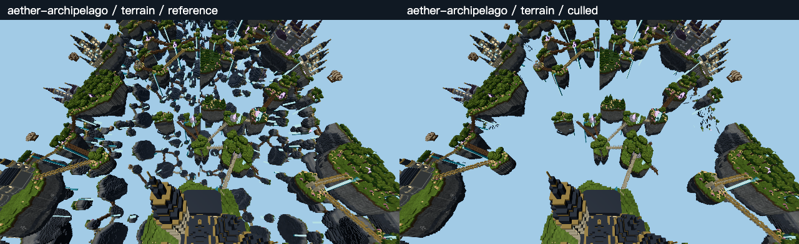
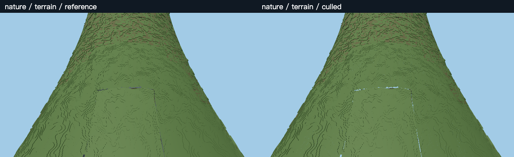
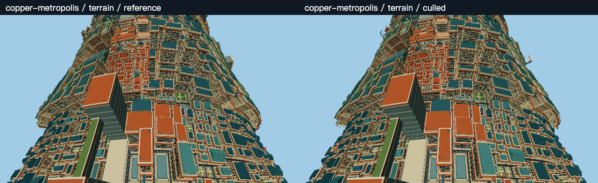

# Torus surface backface filtering — 2026-10-26

Follow-up: the rule is now available as **Settings > Graphics > Distant Terrain
LOD > Torus Backface Culling**, default off. The choice persists locally and
Reset Recommended turns it off. The measurements below describe the earlier
development experiment, not a fresh benchmark of the native integration.

**This saves geometry, but the measured complete-frame gain is modest.** In the
moving workload Aether improves from 89.5 to 93.2 FPS (+4.2%), Copper from 87.6 to
90.5 (+3.2%), and Nature has no demonstrated gain. Aether fixed and rotating views
gain about 6–7%, with visibly fewer islands. Keep this as an optional aggressive
quality tradeoff for further development; the experiment does not enable it in
production.

[Open the interactive picture and performance comparison](performance-torus-backface-2026-10-26.html).
The [numeric summary](../src/dev/results/backface-2026-10-26/summary.json), compressed
raw frames, GPU timelines, controls and PNGs are retained in
`client/src/dev/results/backface-2026-10-26/`.

## What was filtered

The requested interpretation is **reference-torus surface patches facing away
from the camera**. It is not a camera-centered half-ring cutoff. The opposite
inner wall remains when its surface faces the camera. Islands visible through
holes can disappear, as explicitly accepted for this experiment.

For each existing packed visibility block, the prototype computes an ideal
ground-surface point P and outward surface normal n from the block's flat X/Z
bounds. It rejects the block only when an upper bound on `n dot (camera - P)` is
negative over that patch. Coefficients account for the patch's normal variation,
reference-point variation and the offset from the actual block center. The
existing nonlinear tube-angle mapping and periodic seams are preserved.

The test protects blocks within 384 world units, adds an 18-unit camera-cache
motion allowance and a 32-unit horizon allowance. It executes inside the existing
Arena block-facing cache before draw-map construction, so rejected blocks are
omitted from submitted geometry. Rotation alone reuses the classification;
camera-position cache changes recompute it. No shader discard is involved.

This bounds facing on the **ideal torus**, not visibility of the actual voxel
terrain. Large elevation variation, overhangs, caves and building sides can violate
the visual approximation. The rule deliberately permits those errors. Its near
guard is based on the existing bent-space block sphere distance.

Only packed far-Arena blocks are affected. Near meshes and unpacked publication
or transition fallbacks retain their normal behavior. The original PBR materials,
emission, fog, curved projection, LOD planner, geometry storage and command caching
remain. Collision and picking are unchanged. Turning the mode off invalidates
the original visibility cache; disposing removes the temporary method hooks.

## Measurement conditions

- Base revision `3eda06e7fc0651d982dc24fe387a0280d656d6cf`.
- In-app Chromium 156, WebGPU adapter `apple / metal-3`; exact device is masked.
  GPU clocks, temperature and other applications were not controlled.
- 2560 x 1440 canvas, 1280 x 720 CSS viewport, DPR 2, FOV 75. Medium lighting,
  100% fixed resolution, 4x MSAA, shadows off, command caching on.
- Offline fixture with 128 repeated far districts and the ordinary near window.
  Normal animation, physics, sky, HUD and terrain maintenance continue. This is
  one location in each terrain, not a live-server or cross-device benchmark.
- Common player position `(8192.5, 180, 1024.5)`. Fixed: yaw pi/2, pitch -0.85.
  Sweep: yaw `pi/2 + 0.6*sin(2*pi*t)`. Move also adds `16*sin(2*pi*t)` in X and
  `8*(1-cos(2*pi*t))` in Z. Across: fixed yaw pi/2, pitch 1.35. The fixture resets
  velocity and render interpolation; each sampling window repeats the trajectory.
- Preflight both modes and all three picture poses; warm movement and rotation.
  Accepted comparisons use `ABBA BAAB` per motion, A=original, B=filtered:
  four repetitions per mode, 1.2 seconds warm-up and 3 seconds sampling per block.
- Four fixed-view original-only controls precede and follow each world's run.
  They use nominal ABBA / BAAB labels, but every actual mode is original;
  each warms for 1 second and samples for 2 seconds.
- FPS is `1000 / pooled mean RAF interval`, not display presentation telemetry.
  CPU is callback wall time; GPU is first-pass-start to last-pass-end span,
  sampled about every sixth frame, not a GPU utilization counter. Adapter
  timestamps have about 0.066 ms granularity. Screenshots, export, builds and tests
  run outside timing windows. The page stays visible and Play/diagnostics are hidden.

There are 96 accepted comparison blocks, 32,941 frames and 5,488 GPU samples,
plus 24 original-only control blocks. Comparison and control runs report zero
uncaptured WebGPU errors. Warm-up records are retained but excluded from tables.

## Complete-frame results

GPU columns are pooled median spans in milliseconds. Triangle reduction compares
pooled full-scene median submitted counts, including near terrain and other scene
geometry. It is not a reduction in resident memory or world complexity.

| World / motion | Original FPS | Filtered FPS | FPS change | GPU ms original / filtered | Triangles removed |
| --- | ---: | ---: | ---: | ---: | ---: |
| Aether / fixed | 111.8 | 118.5 | +6.04% | 3.670 / 3.146 | 19.2% |
| Aether / sweep | 110.0 | 117.3 | +6.66% | 3.670 / 3.080 | 18.4% |
| Aether / move | 89.5 | 93.2 | +4.19% | 3.670 / 3.015 | 18.1% |
| Aether / across | 120.3 | 120.3 | +0.04% | 2.032 / 1.901 | 9.1% |
| Nature / fixed | 120.0 | 120.0 | -0.01% | 3.015 / 3.146 | 27.8% |
| Nature / sweep | 120.0 | 120.0 | +0.02% | 3.342 / 3.211 | 27.9% |
| Nature / move | 119.5 | 119.1 | -0.36% | 2.556 / 2.621 | 27.2% |
| Nature / across | 120.1 | 120.0 | -0.11% | 2.163 / 2.097 | 18.3% |
| Copper / fixed | 120.0 | 120.0 | -0.02% | 3.801 / 3.473 | 21.5% |
| Copper / sweep | 119.9 | 119.5 | -0.36% | 3.801 / 3.015 | 21.5% |
| Copper / move | 87.6 | 90.5 | +3.25% | 3.867 / 3.080 | 21.3% |
| Copper / across | 120.0 | 120.0 | -0.05% | 2.556 / 2.818 | 7.8% |

| Moving workload | CPU p50 original / filtered, ms | Frame p95 original / filtered, ms | GPU-span reduction |
| --- | ---: | ---: | ---: |
| Aether | 6.2 / 5.9 | 22.3 / 18.7 | 17.9% |
| Nature | 3.4 / 3.3 | 9.2 / 9.2 | -2.6% |
| Copper | 5.9 / 5.5 | 24.9 / 24.8 | 20.3% |

Aether's static/rotating GPU spans fall about 14–16%; its frame p95 improves from
16.1/16.5 ms to 10.2/10.2 ms. Copper's moving median improves, but its slow-frame
tail is essentially unchanged. Nature and the across-ring views remain near the
observed 120 FPS ceiling. Nature's mixed GPU changes do not establish a GPU win.
The roughly 10% larger Copper across-ring span is also not a reliable general
regression claim given the GPU control drift below.

Removing geometry does not remove the ordinary game update, near terrain,
visibility maintenance, LOD publication or browser scheduling costs. The roughly
120 FPS ceiling also limits visible headroom. These measurements explain why
18–28% fewer submitted triangles does not imply a similar FPS improvement. They
do not isolate one universal bottleneck or prove energy savings.

## Repeatability, controls and additional cost

| World | Original-only FPS range before | Original-only FPS range after | Pooled GPU p50 before / after, ms |
| --- | ---: | ---: | ---: |
| Aether | 107.05–115.07 | 108.55–111.53 | 3.736 / 3.998 |
| Nature | 119.96–120.00 | 119.97–120.04 | 3.408 / 2.884 |
| Copper | 119.95–120.01 | 119.93–119.99 | 4.260 / 3.801 |

The Aether fixed and rotating adjacent pairs all improve: +4.4–8.4% and
+4.7–8.4%, respectively. Moving Aether pairs are +9.3%, +2.4%, +5.5%, -0.1%;
moving Copper pairs are +1.4%, +7.0%, +0.5%, +4.3%. Thus the moving gains are
modest and noisy, especially Aether, rather than guaranteed 4% or 3% improvements.
The fixed original-only Aether controls produce nominal label differences of
-3.13% before and +1.21% after, despite no actual mode change. No moving-only
null control or independent cross-device replication was performed.

Reference performance differs from the earlier lighting experiment. Only paired
measurements within this run support the comparisons here; do not subtract
numbers from separate reports to infer a combined improvement.

Normal pending LOD/transition work remains in 114 Aether, 101 Nature and 98 Copper
sampled frames. Nature and Copper each create one new proxy array in a filtered
moving block (including its warm-up), while Aether creates none during comparisons.
Resident faces are constant at 2,127,731 for Aether; ordinary publication changes
Nature from 1,025,655 to 1,025,885 and Copper from 2,799,431 to 2,799,987. These tiny
changes are retained, not hidden or claimed to be culling savings.

Before accepted comparisons, cumulative coefficient allocations were 6.96 MiB /
36.2 ms for Aether, 3.17 MiB / 13.2 ms for Nature, and 8.73 MiB / 34.7 ms for Copper.
These are CPU proxy bytes and cumulative construction wall time across preflight
and warm-up, not precise retained heap or first-frame latency. Initial coefficient
construction is outside timing; camera-dependent rejection work is inside timing.
This prototype retains resident GPU geometry, so it saves no geometry residency.

## Actual picture cost

The nine matched poses contain 18 original full-resolution PNGs and nine labeled
strips. The third, restored-original render at each pose exactly matches the first
image (maximum RGB difference zero), restores its draw/triangle counts and has
identical picking. These are sampled checks, not exhaustive interaction coverage.

| World | Terrain changed pixels | Across-ring changed pixels | Reverse changed pixels |
| --- | ---: | ---: | ---: |
| Aether | 19.154% | 1.025% | 10.180% |
| Nature | 0.192% | 0.000% | 0.096% |
| Copper | 0.313% | 0.038% | 0.359% |

Changed means a maximum RGB channel difference greater than 2, over the entire
frame including sky. It is not a perceptual quality score or a far-terrain-only
percentage. Nature across has a tiny subthreshold difference, not exact equality.

- **Aether:** many islands behind gaps disappear. More sky shows through the ring,
  and some bridges appear to end in empty space. Nearby islands stay. The opposite
  inner wall remains in the across-ring view; this is not removal of half the ring.
- **Nature:** most of the picture remains, but visible thin sky-colored holes or
  seams appear in the terrain and reverse views. The small changed-pixel percentage
  must not be described as artifact-free.
- **Copper:** most facades remain visually similar at overview scale. Some distant
  sides and edge details disappear; differences are small but nonzero.

The cutoff is hard, with no fade or hysteresis beyond the existing camera cache.
The short local movement does not validate long travel across the horizon,
rapid orbiting, edits, teleportation or all publication transitions. Visible popping
and inconsistent cut edges remain possible. These need evaluation before making
this a persistent graphics setting.

## Recommendation and reproduction

Do not enable it globally by default. Aether can justify an explicitly aggressive
performance option if losing background islands is desirable; this run trades a
large picture change for about 4–7% observed FPS gain. Copper is the better visual
tradeoff candidate, but its roughly 3% moving gain and unchanged frame tail do not
solve the slow-frame issue. Nature has no measured FPS benefit and introduces
small holes, so there is no current reason to enable this rule there.

If developed further, first preserve visibly exposed silhouette/terrain edges and
test cutoff transitions on longer camera paths. A slower GPU could benefit more,
but that is a hypothesis, not a result of this experiment. CPU visibility and
publication work still deserve separate attention.

For reproduction, open the offline world with
`dev_offline=1&dev_lod=world&dev_dpr=2`, use the viewport and pose above, press Play,
enable distant terrain and wait for publication to settle. Explicitly import
`TorusBackfaceTrial.ts`, `TorusBackfaceFrames.ts` and `TorusBackfacePixels.ts` from
`client/src/dev/` via Vite's `/@fs/` URLs. Create the trial, capture the preflight,
warm both modes across motions, run before controls, the default 32-block
`runTorusBackfaceFrames(game, trial)`, after controls and the final pixel capture.
Call `trial.dispose()` afterwards. These hooks require offline DEV and have no
production imports.

`client/tools/backface-results.html` reads local IndexedDB and exports the 42-file
ZIP. The report comparison page uses durable PNGs and embedded numeric data and
does not depend on that IndexedDB. Regenerate and validate the summary with
`node client/tools/summarize-torus-backface.mjs`.

Validation: four focused mathematical tests pass (opposite inner wall, near guard,
camera orientation, periodic seams and sampled patch bounds). Client typecheck and
production build pass; production-entry exclusion, initialization and compiler
worker checks pass with existing vendor/circular-chunk/size warnings. All nine
pixel restoration and picking checks pass. Documentation and English checks pass.
