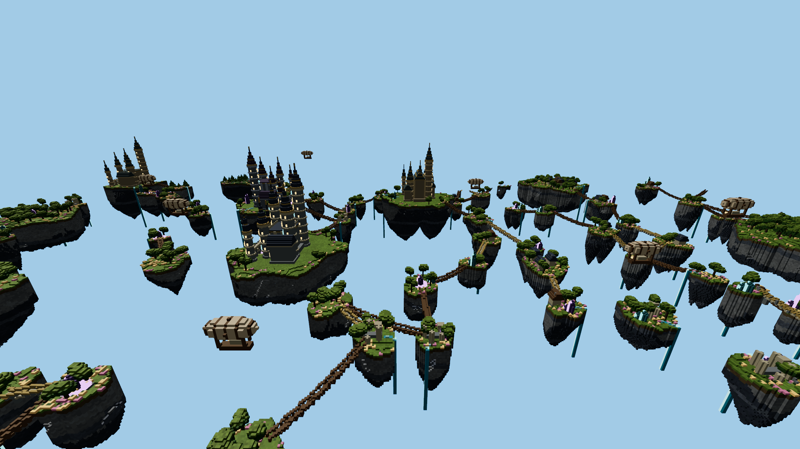
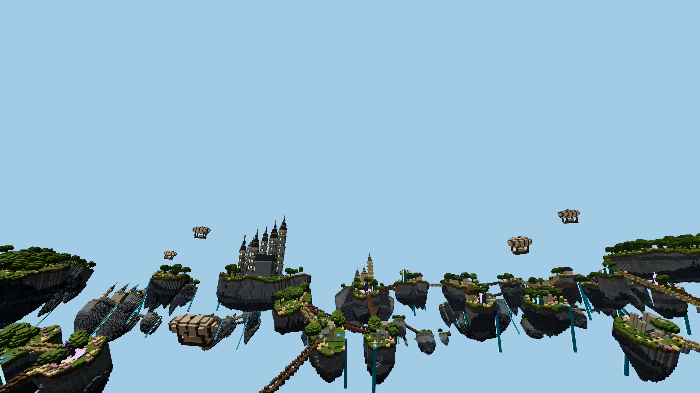

# Flat versus torus terrain rendering, 2026-10-24

Two independent complete runs compare the same generated terrain and mesh topology. The direct geometry-path difference is modest; total terrain rendering varies much more with the view and the geometry surviving culling. These are controlled component measurements, not full-game FPS or a full-world visibility benchmark. No production projection mode or rendering optimization is enabled by this work.

## Matched conditions

- Apple M1 Pro host, 32 GiB memory, macOS 26.5.1; in-app Chromium 155, Three r183 WebGPU. The renderer adapter reports Apple / Metal 3 without a model string. Hardware clocks and other applications were not controlled.
- Actual Nature / Copper Metropolis / Aether Archipelago generators and production seeds. Each fixture covers X [7680,8704), Z [512,1536): the same 1024 x 1024 m footprint in both projections, not the entire torus.
- Detailed AOI: chunks X 504..520, Z 60..68 (153 chunks). Standard and 0.125 m micro meshes use the production meshers. Outside the AOI uses only the 1 m surface mip. No adaptive LOD or resolution changes.
- Far faces use the production packed Arena, 32-face instancing, original map layout, production material and production torus shader (including angular lookup and camera-local correction). Flat uses the same material inputs and geometry with ordinary flat positions/normals. No flat-only greedy remeshing.
- 2560 x 1440, 4x MSAA, identical Medium lighting/material parameters. The timed target is RGBA8; preview uses the same exposure and ACES setting. No shadows, sky dome, Ultra effects, entities, HUD, network, simulation, picking, streaming or presentation are included.
- The surface camera is at the highest standard block in column (8192,1024), plus 1.7 m. Eye heights are Nature 18.7, Copper 2.7 and Aether 121.7 m. Near uses pitch -0.65; forward uses pitch 0.05; both yaw pi/2. Elevated uses yaw pi, pitch -0.35 and max(160, surface+60) m.
- Fixed submission disables software visibility rejection. Culled tests use tight face-AABB bounds per 64 m source brick plus the production 16-face sphere/normal-cone tests, generated independently in flat and torus coordinates. This fixture does not reproduce the production LOD planner's 128 m tile grouping, residency changes or streaming handoffs.
- AOI ownership is removed from the far voxel volume before greedy meshing. Every emitted far face is checked for overlap with the detailed AOI. Existing brick/AOI boundary caps remain; both variants share them.

## Measurement and validation

Each GPU group captures the actual terrain render commands, freezes camera/material buffers, then replays eight complete passes in one command buffer. The reported native timestamp envelope is first-pass-start to last-pass-end divided by eight. There are no JavaScript gaps between these eight passes. It includes pass overhead and possible shared-GPU scheduling; it is not a busy-time counter and must not be inverted into game FPS.

ABBA and BAAB alternate, with four warm-up quartets and 24 measured quartets per comparison. Each case has an independent identical-code A/A control with eight measured quartets. The final table gives equal weight to the two independent run means. Substantial variation between repetitions or in the sham control limits small-effect conclusions.

All fixed-submission cases have identical flat/torus submitted triangle and draw-call counts. Counts include actual direct commands and Arena bundle geometry, including degenerate padding; renderer.info alone omits cached bundle work. Both runs have identical fixture counts and far-record checksums. All 168 full-image native replay fidelity comparisons have zero changed channels, no new pipeline compilation during measured captures, and no GPU validation errors. The one-pixel diagnostic deliberately changes raster coverage and is not an image-quality candidate.

## GPU results

Positive percentages mean the torus took longer. Values are terrain GPU milliseconds per replayed pass.

| World | View | Visibility | Flat ms | Torus ms | Change | Independent-run changes | A/A changes |
| --- | --- | --- | ---: | ---: | ---: | --- | --- |
| Nature | ground-near | fixed-submission | 0.832 | 0.913 | +9.8% | +11.4% / +8.3% | +2.9% / +1.1% |
| Nature | ground-near | frustum | 0.649 | 0.643 | -1.0% | -1.4% / -0.4% | -0.7% / -2.9% |
| Nature | ground-forward | fixed-submission | 0.771 | 0.830 | +7.7% | +4.7% / +11.2% | +2.1% / +0.1% |
| Nature | ground-forward | frustum | 0.572 | 0.587 | +2.5% | +4.2% / +0.0% | -0.0% / +4.4% |
| Nature | elevated-tube | fixed-submission | 1.063 | 0.715 | -32.7% | -32.4% / -33.0% | +0.7% / -0.4% |
| Nature | elevated-tube | frustum | 0.791 | 0.387 | -51.1% | -50.7% / -51.5% | +4.1% / -2.6% |
| Nature | ground-forward | 1-pixel scissor, all faces | 0.777 | 0.852 | +9.6% | +6.4% / +13.5% | +1.5% / -0.3% |
| Copper Metropolis | ground-near | fixed-submission | 2.086 | 2.440 | +17.0% | +16.2% / +17.7% | +0.6% / -5.0% |
| Copper Metropolis | ground-near | frustum | 0.787 | 1.413 | +79.6% | +77.6% / +81.6% | +0.0% / -0.1% |
| Copper Metropolis | ground-forward | fixed-submission | 2.340 | 2.539 | +8.5% | +8.9% / +8.1% | -1.8% / -0.0% |
| Copper Metropolis | ground-forward | frustum | 1.012 | 1.348 | +33.2% | +33.1% / +33.3% | -0.5% / -2.6% |
| Copper Metropolis | elevated-tube | fixed-submission | 2.501 | 2.526 | +1.0% | +0.5% / +1.5% | +1.4% / +3.3% |
| Copper Metropolis | elevated-tube | frustum | 1.001 | 1.285 | +28.4% | +32.4% / +24.7% | -2.7% / -1.1% |
| Copper Metropolis | ground-forward | 1-pixel scissor, all faces | 2.074 | 2.274 | +9.6% | +9.5% / +9.8% | +1.2% / +0.0% |
| Aether Archipelago | ground-near | fixed-submission | 2.372 | 2.662 | +12.2% | +12.1% / +12.4% | +0.1% / -0.4% |
| Aether Archipelago | ground-near | frustum | 0.937 | 1.399 | +49.4% | +46.5% / +52.1% | -11.1% / +1.9% |
| Aether Archipelago | ground-forward | fixed-submission | 2.340 | 2.492 | +6.5% | +7.2% / +5.8% | +0.5% / +0.4% |
| Aether Archipelago | ground-forward | frustum | 0.941 | 1.166 | +24.0% | +24.4% / +23.5% | +3.4% / +4.0% |
| Aether Archipelago | elevated-tube | fixed-submission | 2.437 | 2.568 | +5.4% | +4.9% / +5.9% | +1.7% / -0.5% |
| Aether Archipelago | elevated-tube | frustum | 0.914 | 0.997 | +9.0% | +10.4% / +7.7% | +0.8% / +1.1% |
| Aether Archipelago | ground-forward | 1-pixel scissor, all faces | 2.125 | 2.265 | +6.6% | +6.1% / +7.1% | +1.9% / +1.3% |

The one-pixel comparison suppresses almost all fragment work while retaining the exact submitted geometry. It supports a geometry-path overhead estimate, not a measurement of trigonometry alone: projection changes also affect clipping, primitive processing and GPU data access.

## Surface-forward visibility and CPU work

CPU results are preparation/culling plus render submission during the same deterministic small yaw sweep. They exclude simulation, UI and picking. Submission can include driver backpressure; these are not full-frame CPU timings. CPU and GPU overlap and must not be added together.

| World | Flat submitted triangles | Torus submitted triangles | Flat CPU prepare + submit ms | Torus CPU prepare + submit ms |
| --- | ---: | ---: | ---: | ---: |
| Nature | 271,540 | 275,482 | 0.069 + 0.216 | 0.104 + 0.299 |
| Copper Metropolis | 1,156,318 | 1,489,854 | 0.263 + 0.686 | 0.335 + 1.026 |
| Aether Archipelago | 881,162 | 1,115,690 | 0.301 + 0.845 | 0.411 + 1.234 |

These counts support the explanation that complex torus scenes can retain more geometry after culling. They do not prove that every additional submitted face is visible on screen: conservative bounds, changed facing, occlusion and screen coverage all contribute. Nature from above is an explicit counterexample to a universal slowdown: the curved surface covers less screen area and is faster despite the same resident geometry.

## Fixture sizes

| World | Seed | Far faces | Near triangles | Total real triangles |
| --- | ---: | ---: | ---: | ---: |
| Nature | 20260827 | 330,980 | 174,506 | 836,466 |
| Copper Metropolis | 20260922 | 1,540,362 | 701,002 | 3,781,726 |
| Aether Archipelago | 42 | 1,757,657 | 323,640 | 3,838,954 |

## Interpretation

The results do not support treating the torus as a blanket blocker of standard rendering optimization. Its measurable costs include vertex/normal projection and extra CPU preparation, while the larger view-dependent differences involve visibility and raster coverage. For the current design, tightening conservative bounds and improving visibility rejection deserve attention before a topology redesign. A flat world could also allow longer greedy quads and simpler picking, but neither potential benefit is measured here.

This covers three fixed poses at one deterministic region per world, on one GPU. It does not establish an average for all camera paths, mobile GPUs, the full ring, online gameplay, shadows or Ultra effects. Near and elevated cases should be retained alongside the forward case rather than selecting only favorable percentages.

## Instrument development audit

The retained audit archive contains superseded trials: an initial incomplete micro-mesh attempt, low-altitude/brick-only culling tests, and the later pre-boundary-correction tests. The latter camera correction and production face-block culling materially changed the interpretation. A boundary audit found 117 / 381 / 95 merged source faces crossing AOI edges in Nature / Copper / Aether, so center-point filtering was replaced with ownership removal before meshing. Only the final clipped-fixture runs enter the tables above. Earlier favorable or unfavorable values are not pooled into the accepted result.

## Reproduction and evidence

Run `npm run dev --workspace @entropydrop/space`, open `/space/app/tools/torus-flat-benchmark.html`, and click **Run all three worlds**. Keep the tab visible and do not run builds or other profilers during timing. The Download button exports raw GPU samples, CPU summaries and preview captures. Repeat from a fresh reload.

- [Benchmark entry](../tools/torus-flat-benchmark.html) and [harness](../src/dev/TorusFlatBenchmark.ts).
- [Summary and source hashes](../src/dev/results/torus-flat-summary-2026-10-24.json).
- [Accepted raw first/repeat runs](../src/dev/results/torus-flat-raw-2026-10-24.json.gz).
- [Superseded instrument trials and their harness sources](../src/dev/results/torus-flat-instrument-audit-2026-10-24.json.gz).

## Preview

Identical source terrain and elevated view, first flat and then torus. These images are intentionally different projections; fidelity checks compare each native replay to its own live reference.

## Code checks

All 54 focused torus, face-visibility and Arena tests pass, including a new flat-projection culling check. Engine and client TypeScript checks, inventory checking and the production build pass. The build also checks development-entry exclusion, import-order initialization and compiler-worker recovery. The benchmark entry is covered by the development-code exclusion guard. No full application or server suite was run for this isolated rendering experiment.

The repository-wide English-only check fails on pre-existing Chinese text in `godot-space/PERFORMANCE.md`, which this experiment does not modify.
