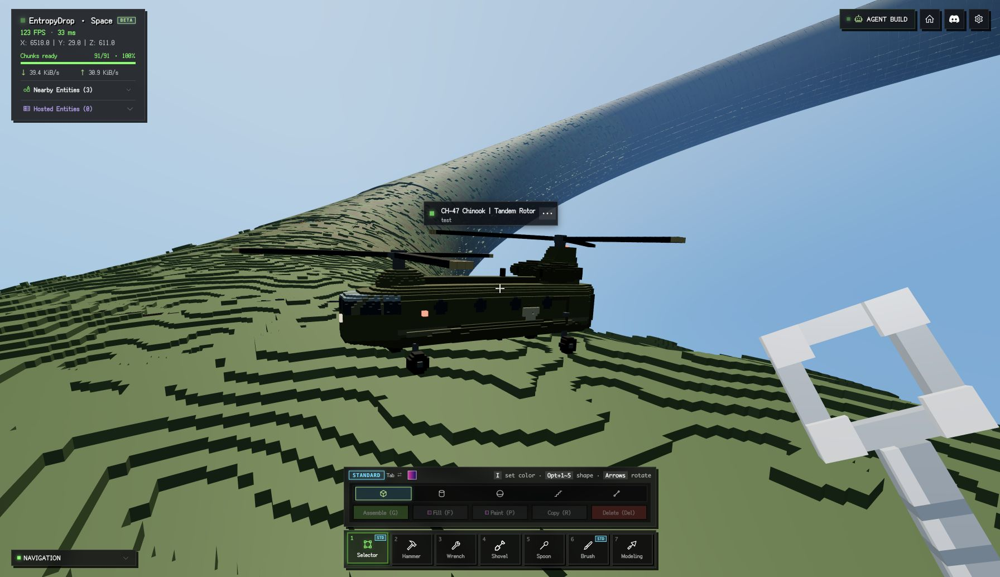

# CH-47 Chinook in local Nature

A voxel interpretation of the Chinook's tandem-rotor silhouette: elongated olive
fuselage, glazed cockpit, round cabin windows, side fuel sponsons, rear engine
nacelles, raised aft transmission tower, four landing-gear stations and two
counter-rotating three-blade rotors. Visual reference:
[Boeing Chinook](https://www.boeing.com.au/products-services/defence-space-security/chinook).

The model uses a bounded animated hover patrol, not an aerodynamic simulation or
a pilot-controlled flight system. Rotor speed is a visual choice of +/-150 RPM.

- Local page: http://localhost:5173/space/app/?world=nature
- World: `00000000-0000-4000-8000-000000000002`
- Entity: `b30dd916-0ce6-4b00-9cc3-71097cc02192`
- Patrol anchor: `(6536, 27, 625)`
- Name: `CH-47 Chinook | Tandem Rotor`
- 18,306 voxels: 48 standard and 18,258 micro voxels.
- Three kinematic components and three compiled AssemblyScript programs.
- No decorations or external texture/model downloads.
- Portable protobuf: 350,230 bytes.

## Measured performance

Measured October 13, 2026, Asia/Shanghai, in the real authenticated local Nature
session. The previously created VOLNA-01 remained running in every condition;
the pre-existing small entity also remained present. These results measure the
incremental cost of one Chinook in that scene.

Chrome 154 on macOS; 3584 x 2068 drawing buffer; device pixel ratio 2; fixed 100%
resolution; High lighting; shadows off; 91 nearby chunks. Player position was
`(6509.54, 19, 609.39)`. Camera, world, loaded chunk count and graphics settings
were verified identical across all nine samples.

Each condition has three runs, each with 2 seconds of warmup and 8 seconds of
measurement. No builds, screenshots or GPU readbacks ran inside the sample windows.

| Condition | Mean RAF FPS | CPU median (ms) | CPU P95 (ms) | Draw calls | Triangles |
| --- | ---: | ---: | --- | ---: | ---: |
| Before Chinook, VOLNA-01 running | 123.8 | 3.1 | 4.1 / 4.2 / 4.1 | 161 | 888,005 |
| Chinook stopped | 124.2 | 3.4 | 4.5 / 4.5 / 4.5 | 202 | 975,245 |
| Chinook rotors and patrol running | 122.2 | 3.6 | 5.2 / 5.2 / 5.2 | 202 | 975,245 |

CPU median is the median of the three per-run medians. The running aircraft added
0.5 ms of median CPU frame work, 41 draw calls and 87,240 triangles. Mean CPU work
increased from 3.279 to 3.823 ms. The roughly 1.3% FPS difference is within the
observed run-to-run variation; it does not establish a significant FPS regression.

CPU measures the synchronous `game.animate` call, excluding GPU completion and
other browser tasks. RAF FPS is derived from animation-frame intervals, not
confirmed display presentation rate. GPU time, GPU memory and power were not
measured. This is a single-aircraft test in one view; it does not predict fleet
scaling or lower-end hardware performance. The camera differs from the earlier
VOLNA-01 test, so absolute results should not be compared across those reports.

The final screenshot was taken afterward from a closer, elevated viewpoint. The
original player position and flight-mode setting were restored after capture.

## Artifacts

- [Summary and fixed settings](performance-summary.json)
- [Portable model](ch47.entity.pb)
- Model, exporter and browser probe sources, plus one final screenshot.

The original per-run samples, creation receipt and runtime verification are
archived locally under `.local/nature-vehicle-evidence/<run>/client/tools/nature-chinook/`
at the repository root; they are not required to build or import the example.
Model counts and aggregate results remain in the committed summary. During the flight
samples, the runtime advanced from tick 245 to 845, changed position within the
bounded patrol, and reported no root or child script errors.

At the original measurement, the definition and running intent were saved
(revision 2), while the old 100/hour checkpoint limit prevented motion saves.
On October 13 the development API was updated to 120/minute and 6000/hour,
and the client gained Retry-After backoff with coalesced saves. Twelve consecutive
tank checkpoints returned 200 during the shared-path verification. The original
aircraft measurements did not establish continuous position persistence.
The authored anchor makes a restarted patrol return to this placement without drifting.

## Reproduction and validation

Run `node client/tools/nature-chinook/export.ts` from the repository root to rebuild
the model. This compiles all three programs, checks the 65,536-voxel limit, checks
micro-cell ownership across components, and verifies the protobuf round trip.
The portable model is written beside the source; decoded `ch47.json` and
`model-stats.json` go to the ignored `.local/nature-vehicle-exports/nature-chinook/`
directory at the repository root. Save new raw profiles in `.local/` as well.
Completely filled single-color cubic metres become standard voxels; partial
metres retain the exterior micro-voxel skin and discard hidden interiors.

For an explicit local development profile, import `probe.ts` through Vite using
`/@fs/ABSOLUTE_REPO_PATH/client/tools/nature-chinook/probe.ts`, call
`configure(game)` once, and then `sample(game, label)` while the tab is visible.
The sampler is reused from `../nature-orb/probe.ts` and is not imported by the app.
The create helper is a manual, localhost-only action with a fixed operation ID;
only retry it with the unchanged model, world and request. A new design requires
a new operation ID. The model's script anchor must be changed for other placements.

Validation passed: all three scripts compiled; authored voxel overlap and quota
checks; portable encode/decode; explicit TypeScript checks for model/export/probe;
repository English-text check and `git diff --check`. No application runtime code
was changed for this second aircraft.
