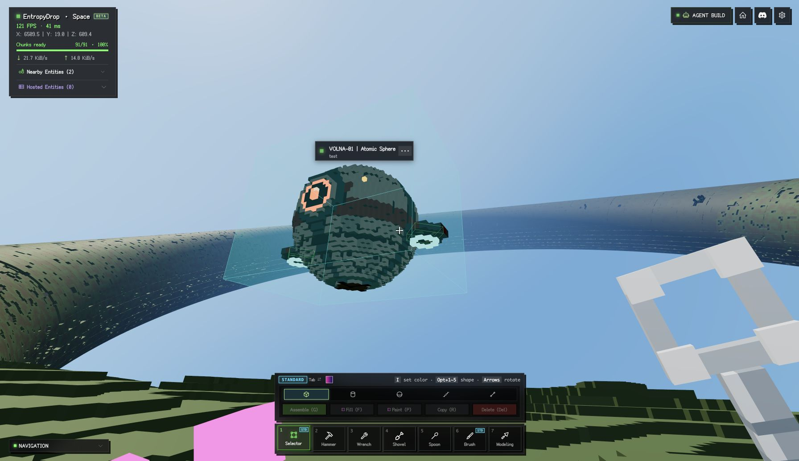

# VOLNA-01 Nature aircraft

An original Atomic Heart-inspired spherical service drone, placed and running in
the local development Nature world. It has a paneled shell, red service stripe,
glowing camera eye, antenna, two counter-rotating ducted turbines, and a bounded
hovering patrol. It uses the existing entity and AssemblyScript systems.

- Page: http://localhost:5173/space/app/?world=nature
- World: `00000000-0000-4000-8000-000000000002`
- Entity: `a9398ea9-3c55-45f7-8b59-08c67180add3`
- Patrol anchor: `(6512, 25, 620.5)`, close to the current player.
- Three kinematic components, three scripts, 7,747 voxels, no decorations.
- Main body: 80 kg, gravity off. Turbines: 1 kg each, collision off, +/-90 RPM.
- Patrol: +/-1.6 m laterally, +/-0.22 m vertically; scripts use the existing
  20 Hz execution tick. There are no external textures or model requests.

## Performance measured on 2026-10-13 (Asia/Shanghai)

Real authenticated Chrome 154, local online Nature map, 3584 x 2068 drawing
buffer, device pixel ratio 2, fixed 100% resolution, High lighting, shadows off.
Player and camera stayed at the same position and orientation, with 91 nearby
chunks and 128 far zones loaded. One pre-existing four-voxel entity remained in
every condition.

Each primary condition has three runs, each with 2 seconds of warmup and
8 seconds of measurement. No screenshots, GPU readbacks, builds or compilation
ran inside these sampling windows.

| Condition | Average RAF FPS | CPU median per run (ms) | CPU P95 per run (ms) | Draw calls | Triangles |
| --- | ---: | --- | --- | ---: | ---: |
| Before adding aircraft | 124.8 | 3.6 / 3.6 / 3.6 | 4.2 / 4.3 / 4.3 | 187 | 726,205 |
| Optimized aircraft stopped | 124.6 | 4.2 / 4.2 / 4.4 | 4.9 / 4.9 / 5.2 | 231 | 755,653 |
| Optimized aircraft flying | 123.6 | 4.7 / 4.8 / 4.7 | 6.0 / 6.1 / 5.9 | 231 | 755,653 |

One aircraft added about 1.1 ms to median CPU frame work, 44 draw calls, and
29,448 triangles in this comparison. The roughly 1% average FPS difference is
smaller than the variation among runs, so this does not establish a significant
FPS regression. One flight run included a 53.7 ms frame interval; its cause was
not established. This is a single-scene, single-aircraft test, not a scaling test.

CPU time measures the synchronous `game.animate` call. RAF cadence is not GPU
time or confirmed display presentation rate. GPU time, GPU memory and power
were not measured. Per-run results are in
[performance-2026-10-13.json](performance-2026-10-13.json); individual frame arrays
were not retained.

The first prototype used 829 individually drawn decorations: 90.5 FPS,
10.6 ms median CPU and 1,047 draw calls. Baking the static plates to the engine's
greedy-meshed micro grid removed this bottleneck while preserving the design.

After the final checkpoint fix and page reload, an additional flight-only run
measured 128.8 RAF FPS and 4.0 ms median CPU, with 213 calls and the same 755,653
triangles. The returned record is archived locally as `final-flight-sample.json`
under `.local/nature-vehicle-evidence/<run>/client/tools/nature-orb/` at the repository
root. That different renderer
state has no matched empty baseline, so it is not pooled into the primary table.

## Saved artifacts and reproduction

- `model.ts`: deterministic source; `createNatureOrb(false)` also reproduces the
  unoptimized decoration prototype.
- `volna-01.entity.pb`: portable protobuf model (146,667 bytes).
- `export.ts`: compiles all three scripts, exports and decodes the protobuf.
- `probe.ts`: explicit development-only sampler; it is not imported by the app.

From the repository root, run `node client/tools/nature-orb/export.ts` to rebuild
the exports. The script's patrol anchor is authored for this placement; update
the anchor before using this model elsewhere.
The portable model is written beside the source; decoded `volna-01.json` goes
to the ignored `.local/nature-vehicle-exports/nature-orb/` directory at the
repository root. Save new raw profiles in `.local/` as well.

For profiling, import `probe.ts` through the local Vite development server and
call `configure(game)` once, then `sample(game, label)` with the tab visible.
On the integrated local frontend, the module URL is
`/@fs/ABSOLUTE_REPO_PATH/client/tools/nature-orb/probe.ts`.
`getCreatedEntity(game)` checks localhost, local API origin and the Nature world
identity before reading the existing entity. It never recreates the entity.
Keep camera, resolution, lighting and loaded terrain constant across conditions;
restore the returned camera/settings if profiling from a different view.

## Checkpoint fix and verification

Stop was serializing temporary disabled script flags into the authored model.
Start enabled them again, changing the definition digest and causing live
checkpoints to fail with `ENTITY_MUST_BE_STOPPED`. World definition encoding now
normalizes this entity-wide playback mask without changing the input. Running
checkpoints send execution state only, including for older saved masks.

The entity definition and running intent were saved and survived page reload.
The final runtime reported `running`, no script error, and no child-script errors.
During the original verification, debugging checkpoints exhausted the old
100/hour quota; at 18:20:05 UTC on October 12 it returned Retry-After 1,988 seconds.
On October 13 the development API was updated to 120/minute and 6000/hour,
and the client gained Retry-After backoff with coalesced saves. Twelve consecutive
tank checkpoints returned 200 during the shared-path verification. That later
check does not add an orb-specific motion-persistence measurement to this report.

Validation passed:

- All 38 `space-entity-sync.test.ts` tests, including the new Stop/Start digest
  and legacy-mask live-checkpoint regression test.
- Client type checking, including inventory types.
- Production build, production module initialization, development-entry
  exclusion and compiler worker checks.
- Three script compilations and model protobuf round trip.

The production build retains existing circular-chunk and bundle-size warnings.
