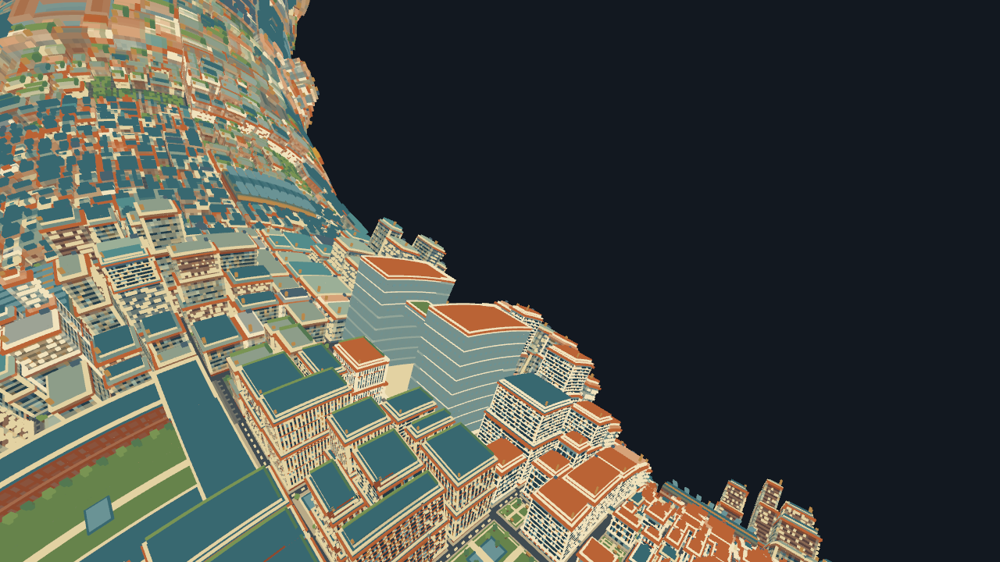

# Copper Metropolis — identical Web LOD comparison

Measured 2026-10-24, Apple M1 Pro, macOS 26.5.1.

**The previous “about 40% faster” comparison is withdrawn as evidence of an
engine speedup.** The two tours used different LODs, geometry counts, lighting,
gameplay workloads, and frame-rate limits. Its raw record is retained only in
`PERFORMANCE-copper-unmatched-archive.md`.

The corrected experiment gives Godot the Web client's actual settled draw
geometry, including its selected far LOD, standard terrain, micro terrain,
visibility, near/far ownership mask, and camera-local torus projection. Both
render **1,571,882 terrain triangles in 93 terrain draws**. It is a **fixed-view
rendering comparison**, not a dynamic LOD or streaming benchmark.

## Results

| Measurement | Web 720p | Godot 720p | Web 1440p | Godot 1440p |
| --- | ---: | ---: | ---: | ---: |
| Average FPS | 119.52 | 117.62 | 120.06 | 117.55 |
| Mean frame interval, ms | 8.37 | 8.50 | 8.33 | 8.51 |
| p95 frame interval, ms | 9.20 | 9.06 | 9.10 | 9.15 |
| p99 frame interval, ms | 9.40 | 9.35 | 9.30 | 10.64 |
| 1% low FPS | 73.68 | 35.83 | 106.46 | 33.14 |
| Worst interval, ms | 100.40 | 98.54 | 10.70 | 92.32 |
| Samples | 2,869 | 2,824 | 2,883 | 2,822 |
| Terrain triangles, every frame | 1,571,882 | 1,571,882 | 1,571,882 | 1,571,882 |
| Terrain draws, every frame | 93 | 93 | 93 | 93 |
| Unfocused frames | 0 | 0 | 0 | 0 |

Both versions approach the common 120 FPS ceiling. **This test does not show a
Godot FPS advantage and cannot rank uncapped maximum throughput.** The smaller
mean differences are not evidence of a reliable engine ranking. The p95
intervals are approximately 9 ms in both. Godot has worse long-tail intervals
in these samples; their cause has not been isolated.

One 24-second sample was taken for each engine/resolution after eight seconds
of warm-up. Web is governed by the approximately 120 Hz browser animation
cadence; Godot's `Engine.max_fps` is explicitly 120, with VSync disabled. These
are different scheduling mechanisms with the same nominal ceiling. This was a
shared workstation, with other apps open. Native UI automation overlapped
parts of warm-up/measurement. The approximately 90–100 ms outliers were kept.
A broader conclusion needs repeated runs on an idle machine and either a
GPU-bound workload below the ceiling or reliable GPU timing.

## What is identical

- Copper seed 20260922, full original 128-district map as the source.
- The Web renderer selects the LOD and culls its draw commands once. Those
  exact commands are captured after all 153 near chunks and far work settle.
  Godot does not substitute its earlier 8 m far mesh or greedy-meshed near
  terrain. The exported list has 42 far-arena draws / 1,410,176 triangles,
  31 standard draws / 149,852 triangles, and 20 micro draws / 11,854 triangles.
- Camera at logical `(8402,240,1264)`, looking toward `(8200,70,1032)`, vertical
  FOV 70°, near/far planes 0.1/10,000. Both use the Web camera-local projection.
- Same ownership mask and near/far coverage. Source geometry and all exported
  mesh files are checked with SHA-256. Godot only reverses index winding to
  accommodate its front-face convention; it preserves the triangles.
- Actual 1280×720 and 2560×1440 output images, 4× MSAA, identical unlit source
  vertex colors and background, no fog, dynamic lighting, shadows, HUD, tools,
  or gameplay simulation. These visual simplifications apply to both sides.
- The LOD snapshot remains frozen at both resolutions. The 1440p run increases
  raster resolution without selecting more detailed geometry on either side.

Web retains the existing Space WebGPU renderer, original packed far arena
buffers, instancing, draw ordering, and terrain material deformation. Godot
uses a release build of the same installed Godot/Voxel Tools engine and
imports the captured geometry as ArrayMeshes. The native positions are
preprojected for this fixed view; Web retains its normal GPU projection.
Their buffer layouts and GPU implementation costs therefore differ even
though the visible triangles are the same. This is not a measurement of
Voxel Tools meshing speed or of the full Web application loop.

The Web counter reports **1,571,883 primitives / 94 calls**. The extra primitive
and call are Three.js's fullscreen output triangle (`Renderer._renderOutput`
and `QuadMesh`), not an extra terrain face. Godot reports **1,571,882 / 93**.
These counts remain constant throughout both measurements. Web output-pass
cost stays in the measured Web rendering path.

## Image and data verification

Both result files reference the exact same manifest SHA-256:

`f3d2d2b1bdddde8d9681189f3e5886158dd62f09158c7422061b6d4de26b1feb`

The 720p screenshots were compared without resizing or alignment. Mean
absolute RGB difference is **0.00995 on a 0–255 scale**. **99.9507%** of all
pixels differ by at most 8 in every channel; excluding the dark background,
that is **99.8997%**. The remaining differences are small rasterization and
floating-point edge differences, not a lower-detail native world.

| Web reference | Godot same geometry |
| --- | --- |
|  |  |

Run `python3 godot-space/matched-lod/verify.py` to verify the recorded mesh
hashes and bounds, cross-engine manifest hashes, triangle/draw counts,
foreground focus, release build, native image dimensions, frame arithmetic,
and image agreement. It needs Pillow and NumPy, available on this machine.

Raw records:

- Web 720p: `results/copper-web-1792804528102.json`.
- Web 1440p: `results/copper-web-1792804596128.json`.
- Godot: `matched-lod/results/godot-720p.json` and `godot-1440p.json`.
- Validation: `matched-lod/results/verification.json`.
- Shared geometry: `matched-lod/data/manifest.json` and `mesh-*.bin`.

Frame intervals are browser animation timestamps or native monotonic process
intervals, not measured presentation/GPU durations. The 1% low is the inverse
of the mean of the slowest 1% of intervals. No memory or startup comparison is
claimed. Generated assets and raw measurements are local, Git-ignored files.

## Run the corrected comparison

Open `matched-lod/launch.command`, press **F9** to measure, and **F6** to switch
720p/1440p. This app is deliberately a fixed-view comparison. The original
free-flight torus tour remains at `launch.command` and still uses its custom
LOD; its performance must not be presented as a matched-LOD engine comparison.

See `matched-lod/README.md` for capture and rebuild steps. A fair moving-tour
comparison still requires matching the changing LOD/residency trace, including
loading, transitions and culling throughout the flight. That work is not
represented by these static results.
