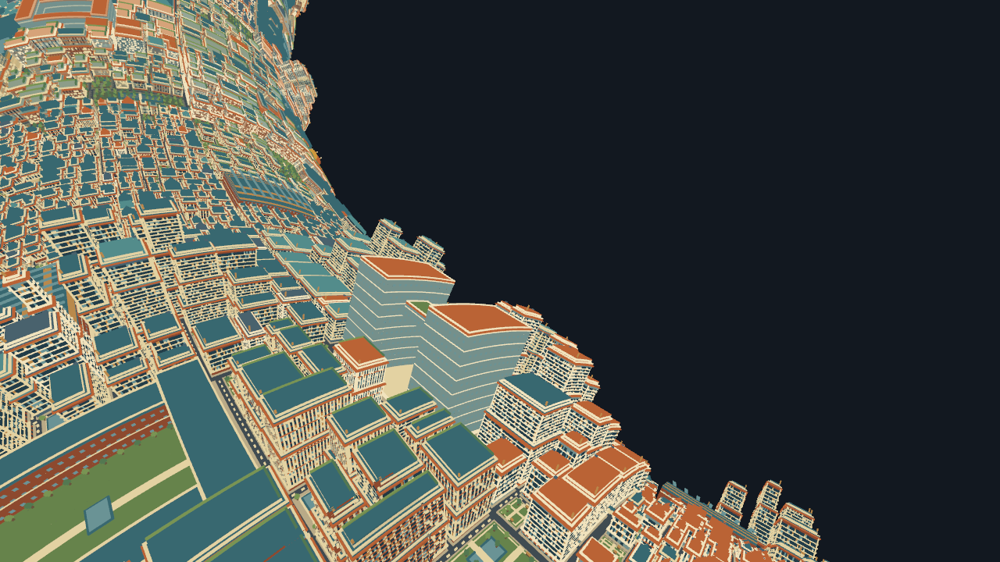

# Copper Metropolis：相同精细 LOD 压力测试

2026-10-24，Apple M1 Pro、32 GiB 内存、macOS 26.5.1。地图 seed 20260922。

**当前 Godot 对照实现没有带来提升。** 在同一份精细地形、相同视点和画面配置下，
4K 两轮平均为 Web **120.03 FPS**、Godot **71.56 FPS**；5K 为 Web **119.94 FPS**、
Godot **59.39 FPS**。这是当前两套静态渲染实现的结果，不能推导为所有 Godot 游戏或
Voxel Tools 实现的性能结论。Web 仍受到约 120 Hz 动画回调上限约束，未测出其无上限吞吐量。

## LOD 实际提高了多少

| 参数 | 前次相同 LOD 基准 | 本次精细档 |
| --- | ---: | ---: |
| 请求细分阈值 | 64 px² | 1 px² |
| 实际有效阈值 | 64 px² | 9.75 px² |
| 几何预算 | 160 MiB | 512 MiB |
| 数据预算 | 512 MiB | 1024 MiB |
| 驻留远景面 | 2,668,593 | 11,183,165 |
| 每帧提交地形三角形 | 1,571,882 | 4,206,058 |
| 每帧地形绘制批次 | 93 | 245 |

精细档使用当前 Web 设置允许的最大几何和数据预算。1 px² 请求触发几何预算限制，
最终实际值为 9.75 px²；另外有 2 个区域受源数据精度限制。不能把本次称为“全地图 1 px²”。
三角形数量实际增加 **2.676 倍**。提交数沿用 GPU 计数定义，包括原有 arena 的退化填充；
两端包含完全相同的填充和近远景遮罩。

同一固定视点下，由 Web 的真实 LOD 选择器先生成并稳定地形，然后导出其实际绘制几何。
Godot 使用这一份几何，不采用原生游览版的另一套 LOD。细分策略只在 1280×720 视口下
执行一次，之后冻结：1440p、4K、5K 只增加输出像素数量，两端都不再重新细分。

## 帧率和帧时间

每轮先预热 8 秒，再记录 24 秒。全程前台，失焦帧均为 0。浏览器测试页和原生应用依次
运行，不同时渲染；构建和图像核验在采样外进行。所有帧间隔都保留，包括卡顿。

| 分辨率 | Web 平均 FPS | Godot 平均 FPS | Web p95 帧间隔 | Godot p95 帧间隔 |
| --- | ---: | ---: | ---: | ---: |
| 1280×720，1 轮 | 120.04 | 102.10 | 9.10 ms | 12.33 ms |
| 2560×1440，1 轮 | 119.85 | 84.90 | 9.10 ms | 16.93 ms |
| 3840×2160，第 1 轮 | 120.02 | 71.61 | 9.10 ms | 20.16 ms |
| 3840×2160，第 2 轮 | 120.04 | 71.51 | 9.90 ms | 20.25 ms |
| 5120×2880，第 1 轮 | 119.88 | 59.23 | 9.80 ms | 23.19 ms |
| 5120×2880，第 2 轮 | 120.00 | 59.55 | 9.70 ms | 22.86 ms |

4K 两轮帧率均值中，Godot 比 Web 低 **40.4%**；5K 低 **50.5%**。等价地，观察到的
Web/Godot FPS 比值分别为 1.68 和 2.02。这些是本次受限帧率的比值，不能作为无上限
引擎吞吐率比值。两轮高分辨率结果接近，但这不是严格的独占机器、随机交替顺序实验。

原生最初还有一轮 720p 测得 115.91 FPS（p95 9.75 ms），窗口辅助功能读取与采样重叠。
该轮保存在 `matched-lod-fine/results/godot-720p-ui-overlap.*`，未混入上表。之后整轮
采样期间不再读取或操作窗口。无 UI 操作的重测反而更低，因此不能把波动归因于自动化；
低分辨率结果只作单轮观察，高分辨率重复测量是主要比较依据。

## 相同条件与实际实现差异

- 同一 Copper 128 区域地图、逻辑相机 `(8402,240,1264)`、目标 `(8200,70,1032)`；
  垂直 FOV 70°，near/far 0.1/10000，相同相机局部甜甜圈投影。
- 相同地形组成：远景 4,044,352 三角形 / 194 批次，标准近景 149,852 / 31，
  微体素 11,854 / 20。相同近远景所有权遮罩和可见范围。
- 相同实际输出分辨率、4× MSAA、无光照顶点色、无阴影、无雾、无 HUD。两边都不运行
  游戏逻辑、LOD 切换、加载或网格生成。原生是发布版，Metal Forward+。
- 两边名义上限为 120 FPS：Web 是浏览器约 120 Hz 的 requestAnimationFrame，Godot
  为 `Engine.max_fps=120`、VSync 关闭。它们的调度机制不同；记录的是回调/进程帧间隔，
  不是直接测量 GPU 时间或屏幕呈现间隔。
- Web 保留已有 WebGPU 渲染器、打包 arena、实例化、顶点变形和输出通道。Godot 使用
  捕获的 ArrayMesh，位置已经按固定视点预投影。缓冲布局、投影计算和引擎管线成本不同。
  **这不测试 Voxel Tools 的运行时 meshing，也不是完整游览的帧率。**
- Web 总计数 4,206,059 三角形 / 246 批次，比地形多一个 Three.js 全屏输出三角形；
  Godot 为 4,206,058 / 245。各轮计数保持恒定，没有通过漏画获得帧率。

本结果支持继续保留现有 Web 渲染方案，不能支持“换成 Godot 就会自动更快”。若要判断
自由游览时的差异，还需比较相同路径上的动态 LOD、加载、过渡、剔除与内存行为。
本次没有测量内存峰值、加载速度或功耗，也没有隔离原生帧时间增加的具体原因。

## 数据与图像核验

所有本次试验引用同一个 manifest SHA-256：

`711f98de39986f36c473abed67ad1713d5caa588cce95a6cdd124370cfc109bd`

逐文件校验导出 mesh SHA-256、字节大小和索引范围，核对两端结果里的 manifest、
绘制计数、输出图片尺寸、MSAA、前台状态、发布构建状态和原始帧时间计算。

| 不缩放、不对齐的像素比较 | 720p | 5K |
| --- | ---: | ---: |
| RGB 平均绝对误差，0–255 | 0.01689 | 0.01659 |
| 每通道误差 ≤8 的全部像素 | 99.9251% | 99.9314% |
| 每通道误差 ≤8 的前景像素 | 99.8470% | 99.8596% |

| Web 精细档 | Godot 同一份几何 |
| --- | --- |
|  |  |

执行 `python3 godot-space/matched-lod-fine/verify.py` 重做完整核验。
原始文件映射与校验汇总在 `matched-lod-fine/results/verification.json`，所有原始每帧
数据保留在相应 JSON 中。5K Web 参考图为 `results/copper-web-1792805804238.png`。
生成的几何、应用与测量数据是本机 Git 忽略文件。

## 重现与保留的版本

打开 `matched-lod-fine/launch.command`：F9 测量，F6 循环 720p / 1440p / 4K / 5K。
见 `matched-lod-fine/README.md` 的完整捕获和构建步骤。最新测量覆盖 `godot-latest.*`，
本次已命名的原始记录不会被覆盖。

前次粗一级的相同 LOD 基准、数据和应用全部保留在 `matched-lod/`，报告为
`PERFORMANCE-matched-baseline.md`；其独立 `verify.py` 再次核验通过。
原来的自由游览版仍在根目录 `launch.command`。早期不同 LOD 的约 40% 提速说法继续
撤回，其历史记录只保留在 `PERFORMANCE-copper-unmatched-archive.md`。
